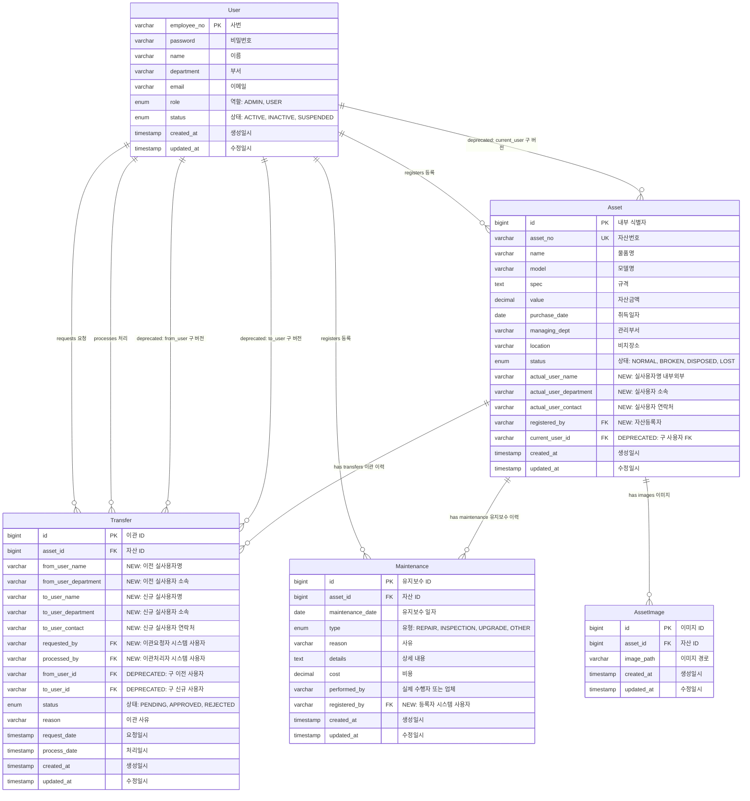
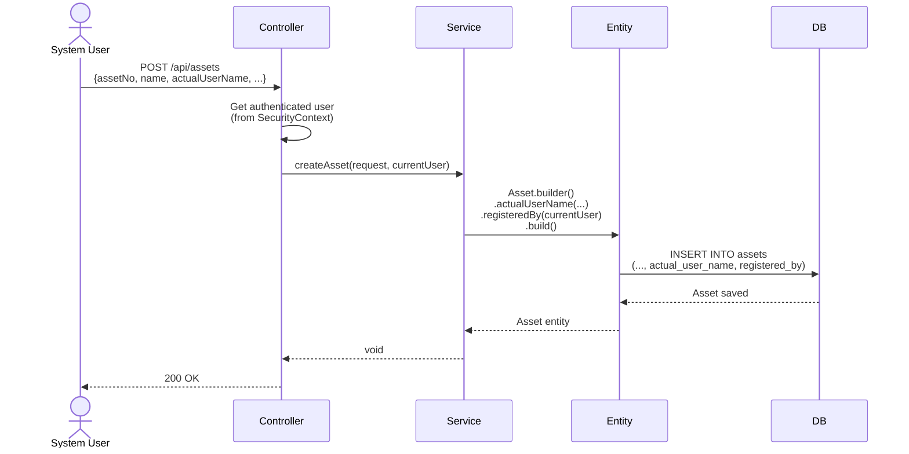
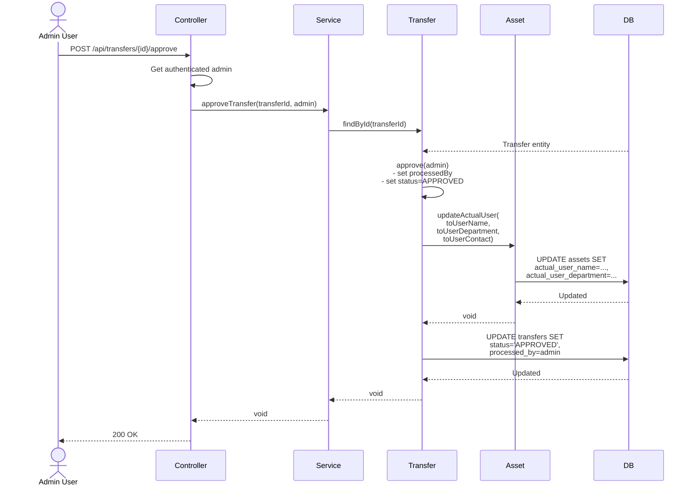

# Asset Schema Redesign - Separating Actual User vs Registrar

## ERD Diagram (Proposed Schema)



### ERD Legend

**Field Markers:**
- `NEW:` - Newly added fields in this redesign
- `DEPRECATED:` - Fields kept for backward compatibility, to be removed in future
- `FK` - Foreign Key relationship
- `PK` - Primary Key
- `UK` - Unique Key

**Key Design Changes:**
1. **Asset Entity**: Separates actual user (can be external) from registrar (system user)
2. **Transfer Entity**: Tracks both actual users (string fields) and system users (FK references)
3. **Maintenance Entity**: Distinguishes performer (string) from registrar (FK to User)

**Relationship Types:**
- `||--o{` = One-to-Many relationship
- Solid lines = Active/Primary relationships
- Relationships marked as "deprecated" will be removed in Phase 4 of migration

## Executive Summary

This document outlines the schema redesign to properly separate two distinct concepts in the asset management system:
1. **Actual User (실사용자)**: The person currently using the asset (can be external, non-system user)
2. **Registrar (자산등록자)**: The system user who registered/manages the asset in the system

## Problem Statement

### Current Design Flaw

The [`Asset`](../src/main/java/org/example/giic_asset/entity/Asset.java) entity currently has a `@ManyToOne` relationship to [`User`](../src/main/java/org/example/giic_asset/entity/User.java) entity via the `user` field:

```java
@ManyToOne(fetch = FetchType.LAZY)
@JoinColumn(name = "current_user_id")
private User user;
```

**Issues:**
- Assumes all asset users are system users (have accounts in the system)
- Cannot track assets used by external personnel, contractors, or non-registered users
- Confuses the concept of "who is using the asset" with "who registered it in the system"
- Database constraint forces `current_user_id` to reference existing users table

### Impact Areas

1. **Entity Layer**: Asset.java, Transfer.java, Maintenance.java
2. **Database Schema**: assets, transfers, maintenance tables
3. **DTO Layer**: AssetRequest, AssetResponse, TransferRequest, etc.
4. **Service Layer**: AssetService, TransferService, MaintenanceService
5. **API Endpoints**: Asset creation, update, transfer operations

---

## Proposed Schema Changes

### 1. Asset Entity Changes

#### Current Structure
```java
@Entity
@Table(name = "assets")
public class Asset extends BaseEntity {
    // ... other fields ...
    
    @ManyToOne(fetch = FetchType.LAZY)
    @JoinColumn(name = "current_user_id")
    private User user;  // PROBLEMATIC: assumes system user
    
    public void changeUser(User user) {
        this.user = user;
    }
}
```

#### Proposed Structure
```java
@Entity
@Table(name = "assets")
public class Asset extends BaseEntity {
    // ... existing fields ...
    
    // === NEW FIELDS FOR ACTUAL USER (실사용자) ===
    @Column(length = 100)
    private String actualUserName;  // Can be anyone - internal or external
    
    @Column(length = 100)
    private String actualUserDepartment;  // Department/organization
    
    @Column(length = 100)
    private String actualUserContact;  // Phone or email for contact
    
    // === NEW FIELD FOR REGISTRAR (자산등록자) ===
    @ManyToOne(fetch = FetchType.LAZY)
    @JoinColumn(name = "registered_by")
    private User registeredBy;  // System user who created this asset record
    
    // === DEPRECATED (Keep for backward compatibility) ===
    @ManyToOne(fetch = FetchType.LAZY)
    @JoinColumn(name = "current_user_id")
    @Deprecated
    private User user;  // To be removed in future version
    
    // === NEW METHODS ===
    public void updateActualUser(String name, String department, String contact) {
        this.actualUserName = name;
        this.actualUserDepartment = department;
        this.actualUserContact = contact;
    }
    
    public void setRegistrar(User registrar) {
        this.registeredBy = registrar;
    }
}
```

#### Database Migration for Assets Table

```sql
-- Step 1: Add new columns (nullable initially for backward compatibility)
ALTER TABLE assets
ADD COLUMN actual_user_name VARCHAR(100) COMMENT '실사용자명 (내부/외부 구분없음)',
ADD COLUMN actual_user_department VARCHAR(100) COMMENT '실사용자 소속',
ADD COLUMN actual_user_contact VARCHAR(100) COMMENT '실사용자 연락처',
ADD COLUMN registered_by VARCHAR(20) COMMENT '자산등록자 (FK to users)',
ADD CONSTRAINT fk_assets_registered_by 
    FOREIGN KEY (registered_by) REFERENCES users(employee_no) ON DELETE SET NULL;

-- Step 2: Migrate existing data
-- Copy current user data to new actual_user_name field
UPDATE assets a
LEFT JOIN users u ON a.current_user_id = u.employee_no
SET a.actual_user_name = u.name,
    a.actual_user_department = u.department
WHERE a.current_user_id IS NOT NULL;

-- Step 3: Set registeredBy to current user as default (can be adjusted)
UPDATE assets a
SET a.registered_by = a.current_user_id
WHERE a.current_user_id IS NOT NULL;

-- Step 4 (Optional - Future): Remove old column after full migration
-- ALTER TABLE assets DROP FOREIGN KEY assets_ibfk_1;
-- ALTER TABLE assets DROP COLUMN current_user_id;
```

### 2. Transfer Entity Changes

#### Current Structure
```java
@Entity
@Table(name = "transfers")
public class Transfer extends BaseEntity {
    @ManyToOne(fetch = FetchType.LAZY)
    @JoinColumn(name = "from_user_id")
    private User fromUser;  // Assumes system user
    
    @ManyToOne(fetch = FetchType.LAZY)
    @JoinColumn(name = "to_user_id", nullable = false)
    private User toUser;  // Assumes system user
    
    private String reason;
    private LocalDateTime requestDate;
    private LocalDateTime processDate;
}
```

#### Proposed Structure
```java
@Entity
@Table(name = "transfers")
public class Transfer extends BaseEntity {
    @ManyToOne(fetch = FetchType.LAZY)
    @JoinColumn(name = "asset_id", nullable = false)
    private Asset asset;
    
    // === ACTUAL USERS (실사용자) - Can be external ===
    @Column(length = 100)
    private String fromUserName;  // Previous actual user name
    
    @Column(length = 100)
    private String fromUserDepartment;  // Previous user's department
    
    @Column(length = 100, nullable = false)
    private String toUserName;  // New actual user name
    
    @Column(length = 100)
    private String toUserDepartment;  // New user's department
    
    @Column(length = 100)
    private String toUserContact;  // Contact info for new user
    
    // === SYSTEM USERS (시스템 사용자) - Who manages the transfer ===
    @ManyToOne(fetch = FetchType.LAZY)
    @JoinColumn(name = "requested_by", nullable = false)
    private User requestedBy;  // System user who initiated this transfer
    
    @ManyToOne(fetch = FetchType.LAZY)
    @JoinColumn(name = "processed_by")
    private User processedBy;  // Admin who approved/rejected
    
    @Enumerated(EnumType.STRING)
    @Column(nullable = false)
    private TransferStatus status;
    
    private String reason;
    private LocalDateTime requestDate;
    private LocalDateTime processDate;
    
    // === DEPRECATED (Keep for backward compatibility) ===
    @ManyToOne(fetch = FetchType.LAZY)
    @JoinColumn(name = "from_user_id")
    @Deprecated
    private User fromUser;
    
    @ManyToOne(fetch = FetchType.LAZY)
    @JoinColumn(name = "to_user_id")
    @Deprecated
    private User toUser;
    
    // === NEW METHODS ===
    public void approve(User approver) {
        this.status = TransferStatus.APPROVED;
        this.processedBy = approver;
        this.processDate = LocalDateTime.now();
    }
    
    public void reject(User rejecter) {
        this.status = TransferStatus.REJECTED;
        this.processedBy = rejecter;
        this.processDate = LocalDateTime.now();
    }
}
```

#### Database Migration for Transfers Table

```sql
-- Step 1: Add new columns
ALTER TABLE asset_transfer_history
ADD COLUMN from_user_name VARCHAR(100) COMMENT '이전 실사용자명',
ADD COLUMN from_user_department VARCHAR(100) COMMENT '이전 실사용자 소속',
ADD COLUMN to_user_name VARCHAR(100) COMMENT '신규 실사용자명',
ADD COLUMN to_user_department VARCHAR(100) COMMENT '신규 실사용자 소속',
ADD COLUMN to_user_contact VARCHAR(100) COMMENT '신규 실사용자 연락처',
ADD COLUMN requested_by VARCHAR(20) COMMENT '이관요청자 (FK)',
ADD COLUMN processed_by VARCHAR(20) COMMENT '이관처리자 (FK)',
ADD CONSTRAINT fk_transfers_requested_by 
    FOREIGN KEY (requested_by) REFERENCES users(employee_no) ON DELETE SET NULL,
ADD CONSTRAINT fk_transfers_processed_by 
    FOREIGN KEY (processed_by) REFERENCES users(employee_no) ON DELETE SET NULL;

-- Step 2: Migrate existing data
UPDATE asset_transfer_history t
LEFT JOIN users u1 ON t.from_user_id = u1.employee_no
LEFT JOIN users u2 ON t.to_user_id = u2.employee_no
SET t.from_user_name = u1.name,
    t.from_user_department = u1.department,
    t.to_user_name = u2.name,
    t.to_user_department = u2.department,
    t.requested_by = t.to_user_id;  -- Assume new user requested it

-- Step 3 (Optional - Future): Remove old columns
-- ALTER TABLE asset_transfer_history DROP FOREIGN KEY fk_from_user;
-- ALTER TABLE asset_transfer_history DROP FOREIGN KEY fk_to_user;
-- ALTER TABLE asset_transfer_history DROP COLUMN from_user_id;
-- ALTER TABLE asset_transfer_history DROP COLUMN to_user_id;
```

### 3. Maintenance Entity Changes

#### Current Structure
```java
@Entity
@Table(name = "maintenance")
public class Maintenance extends BaseEntity {
    @ManyToOne(fetch = FetchType.LAZY)
    @JoinColumn(name = "asset_id", nullable = false)
    private Asset asset;
    
    private LocalDate maintenanceDate;
    private MaintenanceType type;
    private String reason;
    private String details;
    private Long cost;
    private String performedBy;  // Good: already a String
}
```

#### Proposed Structure
```java
@Entity
@Table(name = "maintenance")
public class Maintenance extends BaseEntity {
    @ManyToOne(fetch = FetchType.LAZY)
    @JoinColumn(name = "asset_id", nullable = false)
    private Asset asset;
    
    @Column(nullable = false)
    private LocalDate maintenanceDate;
    
    @Enumerated(EnumType.STRING)
    @Column(nullable = false)
    private MaintenanceType type;
    
    private String reason;
    private String details;
    private Long cost;
    
    // === ACTUAL PERFORMER (실제 수행자) ===
    @Column(length = 100)
    private String performedBy;  // Person/company who did the maintenance
    
    // === NEW: SYSTEM USER WHO REGISTERED THIS RECORD ===
    @ManyToOne(fetch = FetchType.LAZY)
    @JoinColumn(name = "registered_by", nullable = false)
    private User registeredBy;  // System user who created this record
    
    // Update method
    public void update(LocalDate maintenanceDate, MaintenanceType type, 
                      String reason, String details, Long cost, String performedBy) {
        if (maintenanceDate != null) this.maintenanceDate = maintenanceDate;
        if (type != null) this.type = type;
        if (reason != null) this.reason = reason;
        if (details != null) this.details = details;
        if (cost != null) this.cost = cost;
        if (performedBy != null) this.performedBy = performedBy;
    }
}
```

#### Database Migration for Maintenance Table

```sql
-- Add registered_by column
ALTER TABLE maintenance_history
ADD COLUMN registered_by VARCHAR(20) NOT NULL COMMENT '등록자 (시스템 사용자)',
ADD CONSTRAINT fk_maintenance_registered_by 
    FOREIGN KEY (registered_by) REFERENCES users(employee_no) ON DELETE RESTRICT;

-- For existing records, set to admin or first user
-- UPDATE maintenance_history SET registered_by = 'admin' WHERE registered_by IS NULL;
```

---

## DTO Changes

### AssetRequest.java

```java
@Getter
@NoArgsConstructor
public class AssetRequest {
    @NotBlank
    private String assetNo;
    @NotBlank
    private String name;
    private String model;
    private String spec;
    private LocalDate purchaseDate;
    private Long value;
    private String managingDept;
    private String location;
    @NotNull
    private AssetStatus status;
    
    // === NEW FIELDS ===
    private String actualUserName;
    private String actualUserDepartment;
    private String actualUserContact;
    // registeredBy will be set from SecurityContext
    
    public Asset toEntity(User registrar) {
        return Asset.builder()
                .assetNo(assetNo)
                .name(name)
                .model(model)
                .spec(spec)
                .purchaseDate(purchaseDate)
                .value(value)
                .managingDept(managingDept)
                .location(location)
                .status(status)
                .actualUserName(actualUserName)
                .actualUserDepartment(actualUserDepartment)
                .actualUserContact(actualUserContact)
                .registeredBy(registrar)  // From authenticated user
                .build();
    }
}
```

### AssetResponse.java

```java
@Getter
@Builder
@AllArgsConstructor
@NoArgsConstructor
public class AssetResponse {
    private Long id;
    private String assetNo;
    private String name;
    private String model;
    private String spec;
    private LocalDate purchaseDate;
    private Long value;
    private String managingDept;
    private String location;
    private AssetStatus status;
    
    // === NEW FIELDS ===
    private String actualUserName;
    private String actualUserDepartment;
    private String actualUserContact;
    private String registeredByName;
    private String registeredById;
    
    // === DEPRECATED (for backward compatibility) ===
    @Deprecated
    private String userName;  // Map to actualUserName
    @Deprecated
    private String userId;    // Will be null for external users
    
    private List<AssetImageResponse> images;
    
    public static AssetResponse from(Asset asset, List<AssetImageResponse> images) {
        return AssetResponse.builder()
                .id(asset.getId())
                .assetNo(asset.getAssetNo())
                .name(asset.getName())
                .model(asset.getModel())
                .spec(asset.getSpec())
                .purchaseDate(asset.getPurchaseDate())
                .value(asset.getValue())
                .managingDept(asset.getManagingDept())
                .location(asset.getLocation())
                .status(asset.getStatus())
                // New fields
                .actualUserName(asset.getActualUserName())
                .actualUserDepartment(asset.getActualUserDepartment())
                .actualUserContact(asset.getActualUserContact())
                .registeredByName(asset.getRegisteredBy() != null ? 
                    asset.getRegisteredBy().getName() : null)
                .registeredById(asset.getRegisteredBy() != null ? 
                    asset.getRegisteredBy().getEmployeeNo() : null)
                // Deprecated fields for backward compatibility
                .userName(asset.getActualUserName())  // Map to new field
                .userId(null)  // No longer relevant
                .images(images)
                .build();
    }
}
```

### AssetUpdateRequest.java

```java
@Getter
@NoArgsConstructor
public class AssetUpdateRequest {
    private String name;
    private String location;
    private AssetStatus status;
    
    // === NEW FIELDS ===
    private String actualUserName;
    private String actualUserDepartment;
    private String actualUserContact;
}
```

### TransferRequest.java

```java
@Getter
@NoArgsConstructor
public class TransferRequest {
    @NotNull
    private Long assetId;
    
    // === NEW: Actual user information (can be external) ===
    @NotBlank
    private String toUserName;  // Required: who will use the asset
    
    private String toUserDepartment;
    private String toUserContact;
    
    private String reason;
    
    // requestedBy will be set from SecurityContext
}
```

### TransferResponse.java

```java
@Getter
@Builder
@AllArgsConstructor
@NoArgsConstructor
public class TransferResponse {
    private Long id;
    private Long assetId;
    private String assetNo;
    private String assetName;
    
    // === NEW FIELDS ===
    private String fromUserName;
    private String fromUserDepartment;
    private String toUserName;
    private String toUserDepartment;
    private String toUserContact;
    
    private String requestedByName;
    private String requestedById;
    private String processedByName;
    private String processedById;
    
    private TransferStatus status;
    private String reason;
    private LocalDateTime requestDate;
    private LocalDateTime processDate;
    
    public static TransferResponse from(Transfer transfer) {
        return TransferResponse.builder()
                .id(transfer.getId())
                .assetId(transfer.getAsset().getId())
                .assetNo(transfer.getAsset().getAssetNo())
                .assetName(transfer.getAsset().getName())
                .fromUserName(transfer.getFromUserName())
                .fromUserDepartment(transfer.getFromUserDepartment())
                .toUserName(transfer.getToUserName())
                .toUserDepartment(transfer.getToUserDepartment())
                .toUserContact(transfer.getToUserContact())
                .requestedByName(transfer.getRequestedBy() != null ? 
                    transfer.getRequestedBy().getName() : null)
                .requestedById(transfer.getRequestedBy() != null ? 
                    transfer.getRequestedBy().getEmployeeNo() : null)
                .processedByName(transfer.getProcessedBy() != null ? 
                    transfer.getProcessedBy().getName() : null)
                .processedById(transfer.getProcessedBy() != null ? 
                    transfer.getProcessedBy().getEmployeeNo() : null)
                .status(transfer.getStatus())
                .reason(transfer.getReason())
                .requestDate(transfer.getRequestDate())
                .processDate(transfer.getProcessDate())
                .build();
    }
}
```

### MaintenanceRequest.java

```java
@Getter
@NoArgsConstructor
public class MaintenanceRequest {
    @NotNull
    private Long assetId;
    
    @NotNull
    private LocalDate maintenanceDate;
    
    @NotNull
    private MaintenanceType type;
    
    private String reason;
    private String details;
    private Long cost;
    private String performedBy;  // External performer
    
    // registeredBy will be set from SecurityContext
}
```

### MaintenanceResponse.java

```java
@Getter
@Builder
@AllArgsConstructor
@NoArgsConstructor
public class MaintenanceResponse {
    private Long id;
    private Long assetId;
    private String assetNo;
    private String assetName;
    private LocalDate maintenanceDate;
    private MaintenanceType type;
    private String reason;
    private String details;
    private Long cost;
    private String performedBy;
    
    // === NEW FIELDS ===
    private String registeredByName;
    private String registeredById;
    
    public static MaintenanceResponse from(Maintenance maintenance) {
        return MaintenanceResponse.builder()
                .id(maintenance.getId())
                .assetId(maintenance.getAsset().getId())
                .assetNo(maintenance.getAsset().getAssetNo())
                .assetName(maintenance.getAsset().getName())
                .maintenanceDate(maintenance.getMaintenanceDate())
                .type(maintenance.getType())
                .reason(maintenance.getReason())
                .details(maintenance.getDetails())
                .cost(maintenance.getCost())
                .performedBy(maintenance.getPerformedBy())
                .registeredByName(maintenance.getRegisteredBy() != null ? 
                    maintenance.getRegisteredBy().getName() : null)
                .registeredById(maintenance.getRegisteredBy() != null ? 
                    maintenance.getRegisteredBy().getEmployeeNo() : null)
                .build();
    }
}
```

---

## Service Layer Changes

### AssetService.java Changes

```java
@Service
@RequiredArgsConstructor
public class AssetService {
    
    private final AssetRepository assetRepository;
    private final AssetImageRepository assetImageRepository;
    
    @Transactional
    public void createAsset(AssetRequest request, User registrar) {
        if (assetRepository.existsByAssetNo(request.getAssetNo())) {
            throw new BaseException(ErrorCode.DUPLICATE, "이미 존재하는 자산번호입니다.");
        }
        Asset asset = request.toEntity(registrar);
        assetRepository.save(asset);
    }
    
    @Transactional
    public void updateAsset(Long assetId, AssetUpdateRequest request) {
        Asset asset = assetRepository.findById(assetId)
                .orElseThrow(() -> new BaseException(ErrorCode.NOT_FOUND, "자산을 찾을 수 없습니다."));
        
        asset.update(request.getName(), request.getLocation(), request.getStatus());
        
        // Update actual user information
        if (request.getActualUserName() != null || 
            request.getActualUserDepartment() != null || 
            request.getActualUserContact() != null) {
            asset.updateActualUser(
                request.getActualUserName(),
                request.getActualUserDepartment(),
                request.getActualUserContact()
            );
        }
    }
    
    @Transactional(readOnly = true)
    public Page<AssetResponse> getAssetList(Pageable pageable, String keyword, 
                                            AssetStatus status, String dept, 
                                            String actualUserName) {
        Specification<Asset> spec = (root, query, cb) -> cb.conjunction();
        
        if (status != null) {
            spec = spec.and((root, query, cb) -> 
                cb.equal(root.get("status"), status));
        }
        if (dept != null && !dept.isEmpty()) {
            spec = spec.and((root, query, cb) -> 
                cb.equal(root.get("managingDept"), dept));
        }
        if (actualUserName != null && !actualUserName.isEmpty()) {
            spec = spec.and((root, query, cb) -> 
                cb.like(root.get("actualUserName"), "%" + actualUserName + "%"));
        }
        if (keyword != null && !keyword.isEmpty()) {
            spec = spec.and((root, query, cb) -> cb.or(
                    cb.like(root.get("assetNo"), "%" + keyword + "%"),
                    cb.like(root.get("name"), "%" + keyword + "%")
            ));
        }
        
        return assetRepository.findAll(spec, pageable).map(asset -> {
            List<AssetImage> images = assetImageRepository.findByAssetId(asset.getId());
            List<AssetImageResponse> imageResponses = images.stream()
                    .map(AssetImageResponse::from)
                    .collect(Collectors.toList());
            return AssetResponse.from(asset, imageResponses);
        });
    }
}
```

### TransferService.java Changes

```java
@Service
@RequiredArgsConstructor
public class TransferService {
    
    private final TransferRepository transferRepository;
    private final AssetRepository assetRepository;
    
    @Transactional
    public void createTransfer(TransferRequest request, User requestor) {
        Asset asset = assetRepository.findById(request.getAssetId())
                .orElseThrow(() -> new BaseException(ErrorCode.NOT_FOUND, "자산을 찾을 수 없습니다."));
        
        Transfer transfer = Transfer.builder()
                .asset(asset)
                .fromUserName(asset.getActualUserName())
                .fromUserDepartment(asset.getActualUserDepartment())
                .toUserName(request.getToUserName())
                .toUserDepartment(request.getToUserDepartment())
                .toUserContact(request.getToUserContact())
                .requestedBy(requestor)
                .status(TransferStatus.PENDING)
                .reason(request.getReason())
                .requestDate(LocalDateTime.now())
                .build();
        
        transferRepository.save(transfer);
    }
    
    @Transactional
    public void approveTransfer(Long transferId, User approver) {
        Transfer transfer = transferRepository.findById(transferId)
                .orElseThrow(() -> new BaseException(ErrorCode.NOT_FOUND, "이관 요청을 찾을 수 없습니다."));
        
        transfer.approve(approver);
        
        // Update asset's actual user information
        Asset asset = transfer.getAsset();
        asset.updateActualUser(
            transfer.getToUserName(),
            transfer.getToUserDepartment(),
            transfer.getToUserContact()
        );
    }
    
    @Transactional
    public void rejectTransfer(Long transferId, User rejecter) {
        Transfer transfer = transferRepository.findById(transferId)
                .orElseThrow(() -> new BaseException(ErrorCode.NOT_FOUND, "이관 요청을 찾을 수 없습니다."));
        
        transfer.reject(rejecter);
    }
}
```

### MaintenanceService.java Changes

```java
@Service
@RequiredArgsConstructor
public class MaintenanceService {
    
    private final MaintenanceRepository maintenanceRepository;
    private final AssetRepository assetRepository;
    
    @Transactional
    public void createMaintenance(MaintenanceRequest request, User registrar) {
        Asset asset = assetRepository.findById(request.getAssetId())
                .orElseThrow(() -> new BaseException(ErrorCode.NOT_FOUND, "자산을 찾을 수 없습니다."));
        
        Maintenance maintenance = Maintenance.builder()
                .asset(asset)
                .maintenanceDate(request.getMaintenanceDate())
                .type(request.getType())
                .reason(request.getReason())
                .details(request.getDetails())
                .cost(request.getCost())
                .performedBy(request.getPerformedBy())
                .registeredBy(registrar)  // NEW: Track who created this record
                .build();
        
        maintenanceRepository.save(maintenance);
    }
    
    @Transactional
    public void updateMaintenance(Long maintenanceId, MaintenanceRequest request) {
        Maintenance maintenance = maintenanceRepository.findById(maintenanceId)
                .orElseThrow(() -> new BaseException(ErrorCode.NOT_FOUND, "유지보수 기록을 찾을 수 없습니다."));
        
        maintenance.update(
            request.getMaintenanceDate(),
            request.getType(),
            request.getReason(),
            request.getDetails(),
            request.getCost(),
            request.getPerformedBy()
        );
        // Note: registeredBy is NOT updated - it tracks original creator
    }
}
```

---

## Controller Layer Changes

### AssetController.java

```java
@RestController
@RequestMapping("/api/assets")
@RequiredArgsConstructor
public class AssetController {
    
    private final AssetService assetService;
    
    @PostMapping
    public ApiResponse<Void> createAsset(
            @Valid @RequestBody AssetRequest request,
            @AuthenticationPrincipal CustomUserDetails userDetails) {
        User currentUser = userDetails.getUser();
        assetService.createAsset(request, currentUser);
        return ApiResponse.success();
    }
    
    @GetMapping
    public ApiResponse<PageResponse<AssetResponse>> getAssets(
            @RequestParam(required = false) String keyword,
            @RequestParam(required = false) AssetStatus status,
            @RequestParam(required = false) String dept,
            @RequestParam(required = false) String actualUserName,  // NEW
            Pageable pageable) {
        Page<AssetResponse> assets = assetService.getAssetList(
            pageable, keyword, status, dept, actualUserName);
        return ApiResponse.success(PageResponse.of(assets));
    }
    
    // ... other endpoints
}
```

### TransferController.java

```java
@RestController
@RequestMapping("/api/transfers")
@RequiredArgsConstructor
public class TransferController {
    
    private final TransferService transferService;
    
    @PostMapping
    public ApiResponse<Void> createTransfer(
            @Valid @RequestBody TransferRequest request,
            @AuthenticationPrincipal CustomUserDetails userDetails) {
        User currentUser = userDetails.getUser();
        transferService.createTransfer(request, currentUser);
        return ApiResponse.success();
    }
    
    @PostMapping("/{transferId}/approve")
    public ApiResponse<Void> approveTransfer(
            @PathVariable Long transferId,
            @AuthenticationPrincipal CustomUserDetails userDetails) {
        User currentUser = userDetails.getUser();
        transferService.approveTransfer(transferId, currentUser);
        return ApiResponse.success();
    }
    
    @PostMapping("/{transferId}/reject")
    public ApiResponse<Void> rejectTransfer(
            @PathVariable Long transferId,
            @AuthenticationPrincipal CustomUserDetails userDetails) {
        User currentUser = userDetails.getUser();
        transferService.rejectTransfer(transferId, currentUser);
        return ApiResponse.success();
    }
    
    // ... other endpoints
}
```

### MaintenanceController.java

```java
@RestController
@RequestMapping("/api/maintenance")
@RequiredArgsConstructor
public class MaintenanceController {
    
    private final MaintenanceService maintenanceService;
    
    @PostMapping
    public ApiResponse<Void> createMaintenance(
            @Valid @RequestBody MaintenanceRequest request,
            @AuthenticationPrincipal CustomUserDetails userDetails) {
        User currentUser = userDetails.getUser();
        maintenanceService.createMaintenance(request, currentUser);
        return ApiResponse.success();
    }
    
    // ... other endpoints
}
```

---

## Migration Strategy

### Phase 1: Preparation (No Breaking Changes)
1. ✅ Add new columns to database tables (all nullable)
2. ✅ Add new fields to entity classes (keep old fields with @Deprecated)
3. ✅ Update DTOs to include new fields
4. ✅ Deploy schema changes to production

### Phase 2: Dual-Write Period
1. ✅ Update services to write to both old and new fields
2. ✅ Update controllers to accept new field names
3. ✅ Run data migration scripts to populate new fields from old data
4. ✅ Frontend can start using new API fields
5. ✅ Monitor for any issues

### Phase 3: Switch to New Schema
1. ✅ Update all queries to use new fields
2. ✅ Stop writing to deprecated fields
3. ✅ Update all API consumers to use new field names
4. ✅ Verify no code uses deprecated fields

### Phase 4: Cleanup (Breaking Changes)
1. ✅ Remove @Deprecated annotations
2. ✅ Drop old database columns (current_user_id, from_user_id, to_user_id)
3. ✅ Remove deprecated DTO fields
4. ✅ Remove deprecated entity fields

---

## Complete Database Schema (After Migration)

```sql
-- Updated Assets table
CREATE TABLE IF NOT EXISTS assets (
    id BIGINT AUTO_INCREMENT PRIMARY KEY COMMENT '내부 식별자',
    asset_no VARCHAR(50) NOT NULL UNIQUE COMMENT '자산번호',
    name VARCHAR(100) NOT NULL COMMENT '물품명',
    model VARCHAR(100) COMMENT '모델명',
    spec TEXT COMMENT '규격',
    value DECIMAL(15, 2) COMMENT '자산금액',
    purchase_date DATE COMMENT '취득일자',
    managing_dept VARCHAR(50) COMMENT '관리부서',
    location VARCHAR(100) COMMENT '비치장소',
    status VARCHAR(20) NOT NULL DEFAULT 'NORMAL' COMMENT 'NORMAL / BROKEN / DISPOSED / LOST',
    
    -- Actual User (can be external)
    actual_user_name VARCHAR(100) COMMENT '실사용자명 (내부/외부)',
    actual_user_department VARCHAR(100) COMMENT '실사용자 소속',
    actual_user_contact VARCHAR(100) COMMENT '실사용자 연락처',
    
    -- Registrar (system user)
    registered_by VARCHAR(20) COMMENT '자산등록자 (FK)',
    
    created_at TIMESTAMP DEFAULT CURRENT_TIMESTAMP,
    updated_at TIMESTAMP DEFAULT CURRENT_TIMESTAMP ON UPDATE CURRENT_TIMESTAMP,
    
    FOREIGN KEY (registered_by) REFERENCES users(employee_no) ON DELETE SET NULL
) COMMENT='자산 정보 관리';

-- Updated Transfer table
CREATE TABLE IF NOT EXISTS asset_transfer_history (
    id BIGINT AUTO_INCREMENT PRIMARY KEY,
    asset_id BIGINT NOT NULL COMMENT '자산 ID (FK)',
    
    -- Actual users (can be external)
    from_user_name VARCHAR(100) COMMENT '이전 실사용자명',
    from_user_department VARCHAR(100) COMMENT '이전 실사용자 소속',
    to_user_name VARCHAR(100) NOT NULL COMMENT '신규 실사용자명',
    to_user_department VARCHAR(100) COMMENT '신규 실사용자 소속',
    to_user_contact VARCHAR(100) COMMENT '신규 실사용자 연락처',
    
    -- System users (who manages the transfer)
    requested_by VARCHAR(20) NOT NULL COMMENT '이관요청자 (시스템 사용자)',
    processed_by VARCHAR(20) COMMENT '이관처리자 (시스템 사용자)',
    
    status VARCHAR(20) NOT NULL DEFAULT 'PENDING' COMMENT 'PENDING / APPROVED / REJECTED',
    reason VARCHAR(255) COMMENT '이관 사유',
    request_date TIMESTAMP NOT NULL COMMENT '요청일시',
    process_date TIMESTAMP COMMENT '처리일시',
    created_at TIMESTAMP DEFAULT CURRENT_TIMESTAMP,
    updated_at TIMESTAMP DEFAULT CURRENT_TIMESTAMP ON UPDATE CURRENT_TIMESTAMP,
    
    FOREIGN KEY (asset_id) REFERENCES assets(id) ON DELETE CASCADE,
    FOREIGN KEY (requested_by) REFERENCES users(employee_no) ON DELETE RESTRICT,
    FOREIGN KEY (processed_by) REFERENCES users(employee_no) ON DELETE SET NULL
) COMMENT='자산 이관 이력';

-- Updated Maintenance table
CREATE TABLE IF NOT EXISTS maintenance_history (
    id BIGINT AUTO_INCREMENT PRIMARY KEY,
    asset_id BIGINT NOT NULL COMMENT '자산 ID (FK)',
    maintenance_date DATE NOT NULL COMMENT '유지/보수 일자',
    type VARCHAR(20) NOT NULL COMMENT 'REPAIR / INSPECTION / UPGRADE / OTHER',
    reason VARCHAR(100) NOT NULL COMMENT '사유',
    details TEXT COMMENT '상세 내용',
    cost DECIMAL(15, 2) DEFAULT 0 COMMENT '비용',
    
    -- Actual performer (can be external company/person)
    performed_by VARCHAR(100) COMMENT '실제 수행자/업체',
    
    -- System user who registered this record
    registered_by VARCHAR(20) NOT NULL COMMENT '등록자 (시스템 사용자)',
    
    created_at TIMESTAMP DEFAULT CURRENT_TIMESTAMP,
    updated_at TIMESTAMP DEFAULT CURRENT_TIMESTAMP ON UPDATE CURRENT_TIMESTAMP,
    
    FOREIGN KEY (asset_id) REFERENCES assets(id) ON DELETE CASCADE,
    FOREIGN KEY (registered_by) REFERENCES users(employee_no) ON DELETE RESTRICT
) COMMENT='유지/보수 이력 관리';
```

---

## Data Flow Diagrams

### Asset Creation Flow



### Transfer Approval Flow



---

## Backward Compatibility Considerations

### API Compatibility

1. **Deprecated Fields**: Keep `userName` and `userId` in `AssetResponse` for a transition period
   - Map `userName` → `actualUserName`
   - Set `userId` → `null` (no longer applicable)

2. **Search Parameters**: Support both old and new parameter names
   - `userId` (deprecated) → search by `actualUserName`
   - `actualUserName` (new) → direct search

3. **Response Format**: Include both old and new fields during transition
   - Frontend can migrate incrementally
   - Old API consumers continue to work

### Database Compatibility

1. **Dual-Write Period**: Write to both old and new columns
2. **Foreign Keys**: Keep old FK constraints until cleanup phase
3. **Nullable Columns**: All new columns start as nullable for safety
4. **Data Migration**: Run scripts to copy existing data to new schema

---

## Testing Checklist

### Unit Tests
- [ ] Asset entity with actualUser fields
- [ ] Transfer entity with requestedBy/processedBy
- [ ] Maintenance entity with registeredBy
- [ ] DTO conversions (Request → Entity, Entity → Response)
- [ ] Service methods with User parameter

### Integration Tests
- [ ] Create asset with authenticated user as registrar
- [ ] Create asset with external actual user
- [ ] Transfer asset between external users
- [ ] Transfer approval updates asset's actual user
- [ ] Maintenance creation tracks system user
- [ ] Search assets by actual user name

### API Tests
- [ ] POST /api/assets with actualUserName
- [ ] GET /api/assets?actualUserName=...
- [ ] POST /api/transfers with toUserName
- [ ] POST /api/transfers/{id}/approve
- [ ] POST /api/maintenance with registeredBy auto-set
- [ ] Verify backward compatibility with deprecated fields

---

## Implementation Checklist

### Database Changes
- [ ] Create migration script for assets table
- [ ] Create migration script for transfers table
- [ ] Create migration script for maintenance table
- [ ] Test migration on development database
- [ ] Create rollback scripts

### Entity Changes
- [ ] Update Asset.java with new fields
- [ ] Update Transfer.java with new fields
- [ ] Update Maintenance.java with new fields
- [ ] Add @Deprecated to old fields
- [ ] Add new methods (updateActualUser, etc.)

### DTO Changes
- [ ] Update AssetRequest.java
- [ ] Update AssetResponse.java
- [ ] Update AssetUpdateRequest.java
- [ ] Update TransferRequest.java
- [ ] Update TransferResponse.java
- [ ] Update MaintenanceRequest.java
- [ ] Update MaintenanceResponse.java

### Service Changes
- [ ] Update AssetService.createAsset() to accept User
- [ ] Update AssetService.getAssetList() search parameters
- [ ] Update TransferService.createTransfer() to accept User
- [ ] Update TransferService.approveTransfer() to accept User
- [ ] Update MaintenanceService.createMaintenance() to accept User

### Controller Changes
- [ ] Update AssetController to inject User from SecurityContext
- [ ] Update TransferController to inject User
- [ ] Update MaintenanceController to inject User
- [ ] Add new query parameters for filtering

### Frontend Changes (Separate Task)
- [ ] Update asset creation form with actualUser fields
- [ ] Update asset list to display actualUserName
- [ ] Update transfer form to use toUserName instead of toUserId
- [ ] Update maintenance form (no visible changes)
- [ ] Add filtering by actual user name

---

## Benefits of New Design

### 1. Flexibility
- ✅ Support external users without creating system accounts
- ✅ Track asset usage by anyone (employees, contractors, visitors)
- ✅ No artificial constraints on who can use assets

### 2. Auditability
- ✅ Know who registered each asset in the system
- ✅ Know who requested each transfer
- ✅ Know which admin approved/rejected transfers
- ✅ Know who created each maintenance record

### 3. Data Integrity
- ✅ Actual user information is always available (not dependent on User FK)
- ✅ System user relationships track accountability
- ✅ No orphaned records when users are deleted

### 4. Clarity
- ✅ Clear separation between "who uses it" vs "who manages it"
- ✅ Self-documenting field names
- ✅ Better matches business domain language

---

## Risks and Mitigation

### Risk 1: Data Migration Complexity
**Mitigation:**
- Comprehensive migration scripts with validation
- Test on copy of production data
- Dual-write period to ensure data consistency
- Rollback plan ready

### Risk 2: API Breaking Changes
**Mitigation:**
- Keep deprecated fields during transition
- Version API if necessary
- Clear migration guide for frontend team
- Gradual rollout with feature flags

### Risk 3: Performance Impact
**Mitigation:**
- Add indexes on new search columns (actual_user_name)
- Monitor query performance
- Use EXPLAIN to verify query plans
- Consider materialized views if needed

### Risk 4: User Confusion
**Mitigation:**
- Clear UI labels (실사용자 vs 등록자)
- Help text explaining difference
- Admin training documentation
- FAQ for common questions

---

## Next Steps

1. **Review & Approve**: Get stakeholder approval on this design
2. **Create Subtasks**: Break down implementation into manageable tasks
3. **Database Scripts**: Write and test migration SQL scripts
4. **Backend Implementation**: Update entities, DTOs, services in order
5. **API Documentation**: Update Swagger/OpenAPI specs
6. **Frontend Coordination**: Share API changes with frontend team
7. **Testing**: Comprehensive testing at each layer
8. **Deployment**: Phased rollout with monitoring

---

## Questions for Stakeholders

1. **Data Migration**: For existing assets with `current_user_id`, should we:
   - Copy user name to `actual_user_name`? (Recommended)
   - Leave `actual_user_name` blank and require manual entry?

2. **Registrar Default**: For existing assets, should `registered_by` be:
   - Set to `current_user_id`? (Recommended)
   - Set to admin account?
   - Left as NULL?

3. **Transfer History**: Should we migrate old transfer records?
   - Convert to new format with user names?
   - Keep as-is (deprecated format)?

4. **Timeline**: What is the preferred migration timeline?
   - Immediate (next release)?
   - Gradual (dual-write for N weeks)?
   - Coordinate with other changes?

---

## Conclusion

This redesign properly separates the concepts of:
- **Actual users** (who physically use assets) - can be anyone
- **System users** (who manage records) - must be authenticated

The migration strategy ensures backward compatibility while enabling the system to properly handle external asset users. The phased approach minimizes risk and allows for incremental testing and rollout.

The new schema is more flexible, auditable, and aligned with the real-world business process of asset management.
