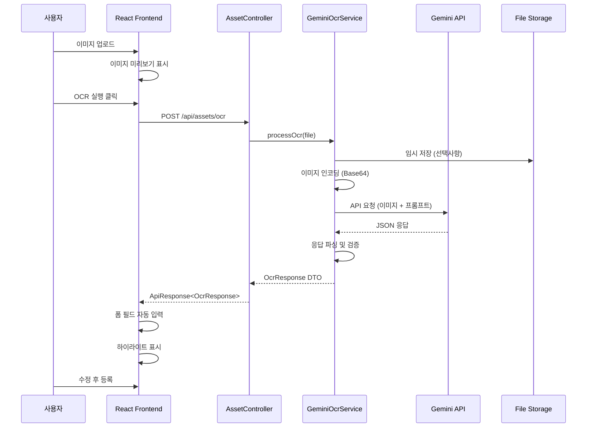
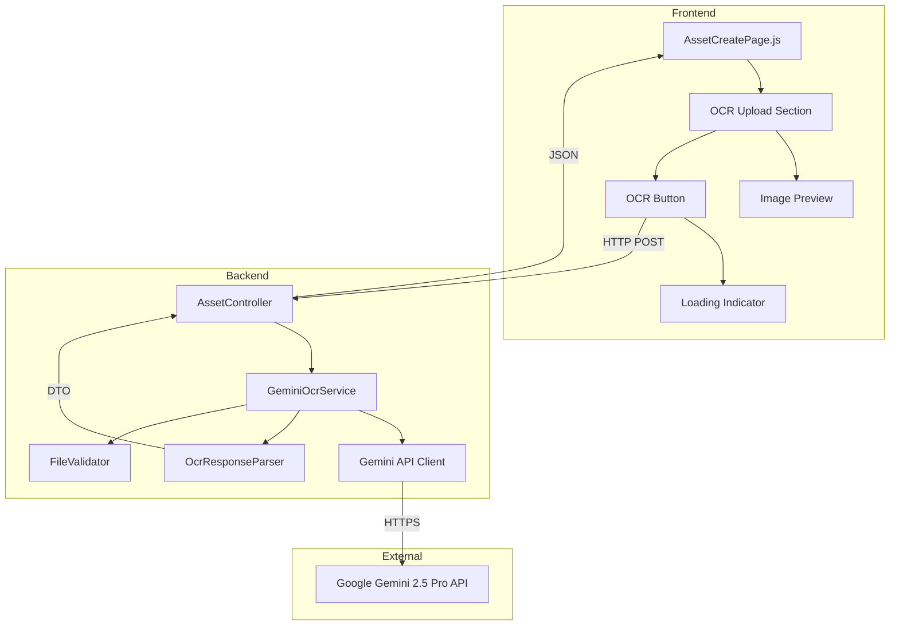
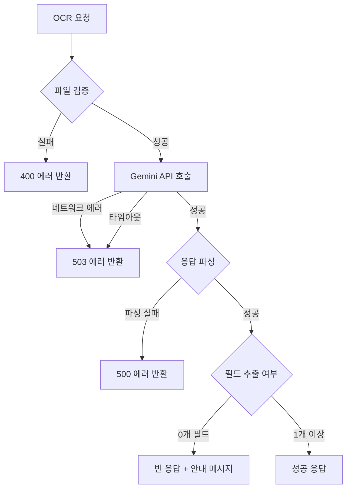

# OCR 기능 설계 문서 (Gemini 2.5 Pro 연동)

## 1. 개요

### 1.1 목적
GIIC Asset Management System에 자산 라벨/명판 이미지를 자동으로 분석하여 자산 정보를 추출하는 OCR 기능을 추가합니다. Google Gemini 2.5 Pro API를 활용하여 이미지에서 텍스트를 인식하고 구조화된 데이터로 변환합니다.

### 1.2 범위
- 백엔드: Gemini API 연동 서비스 구현
- 프론트엔드: OCR 실행 UI 및 결과 자동 입력
- 추출 대상 필드: 자산번호, 물품명, 모델명, 제조사, 스펙

### 1.3 기술 스택
- Backend: Spring Boot 4.0.2, Java 17
- Frontend: React 19.x
- AI: Google Gemini 2.5 Pro API
- 기존 의존성: Spring Web, Validation, Lombok

---

## 2. 시스템 아키텍처

### 2.1 전체 흐름도



### 2.2 컴포넌트 구조



---

## 3. API 설계

### 3.1 OCR 엔드포인트

#### 요청
```http
POST /api/assets/ocr
Content-Type: multipart/form-data

file: [이미지 파일]
```

**파라미터:**
- `file` (required): MultipartFile
  - 지원 형식: JPG, JPEG, PNG, WEBP
  - 최대 크기: 10MB (기존 설정 사용)

#### 응답
```json
{
  "success": true,
  "data": {
    "assetNo": "GIIC-2024-001",
    "name": "노트북",
    "model": "ThinkPad X1 Carbon Gen 11",
    "manufacturer": "Lenovo",
    "spec": "Intel i7-1355U, 16GB RAM, 512GB SSD",
    "confidence": 0.92,
    "extractedFields": ["assetNo", "name", "model", "manufacturer", "spec"]
  },
  "message": "OCR 처리가 완료되었습니다."
}
```

**OcrResponse DTO 구조:**
```java
@Getter
@Builder
@AllArgsConstructor
@NoArgsConstructor
public class OcrResponse {
    private String assetNo;          // 자산번호/시리얼번호
    private String name;             // 물품명
    private String model;            // 모델명
    private String manufacturer;     // 제조사 (옵션)
    private String spec;             // 스펙 (옵션)
    private Double confidence;       // 신뢰도 (0.0-1.0)
    private List<String> extractedFields; // 추출된 필드 목록
}
```

### 3.2 에러 응답

#### 파일 검증 실패
```json
{
  "success": false,
  "error": {
    "code": "E400",
    "message": "지원하지 않는 이미지 형식입니다."
  }
}
```

#### Gemini API 호출 실패
```json
{
  "success": false,
  "error": {
    "code": "E503",
    "message": "OCR 서비스에 일시적인 문제가 발생했습니다. 잠시 후 다시 시도해주세요."
  }
}
```

#### OCR 결과 없음
```json
{
  "success": true,
  "data": {
    "assetNo": null,
    "name": null,
    "model": null,
    "manufacturer": null,
    "spec": null,
    "confidence": 0.0,
    "extractedFields": []
  },
  "message": "이미지에서 자산 정보를 찾을 수 없습니다."
}
```

---

## 4. Gemini API 연동 설계

### 4.1 의존성 추가

**build.gradle에 추가:**
```gradle
dependencies {
    // 기존 의존성...
    
    // Google Gemini API
    implementation 'com.google.cloud:google-cloud-aiplatform:3.45.0'
    
    // 또는 REST API 사용 시
    implementation 'org.springframework.boot:spring-boot-starter-webflux'
    implementation 'com.google.code.gson:gson:2.10.1'
}
```

### 4.2 프롬프트 설계

#### 시스템 프롬프트
```text
You are an expert OCR system specialized in extracting asset information from equipment labels, nameplates, and stickers.

Your task is to analyze the provided image and extract the following information:
1. Asset Number / Serial Number (assetNo)
2. Product Name (name)
3. Model Name (model)
4. Manufacturer (manufacturer)
5. Specifications (spec)

IMPORTANT INSTRUCTIONS:
- Extract ONLY the information that is clearly visible in the image
- For assetNo: Look for serial numbers, asset tags, product codes
- For name: Extract the product category or item name (e.g., "Laptop", "Monitor", "Printer")
- For model: Extract the specific model designation
- For manufacturer: Extract the brand or company name
- For spec: Extract technical specifications like CPU, RAM, storage, dimensions, etc.
- If a field cannot be determined, return null for that field
- Return ONLY valid JSON format, no additional text
- Use Korean language for product names when appropriate

Response format:
{
  "assetNo": "extracted value or null",
  "name": "extracted value or null",
  "model": "extracted value or null",
  "manufacturer": "extracted value or null",
  "spec": "extracted value or null"
}
```

#### 실제 요청 구조
```json
{
  "contents": [
    {
      "role": "user",
      "parts": [
        {
          "text": "[위 시스템 프롬프트]"
        },
        {
          "inline_data": {
            "mime_type": "image/jpeg",
            "data": "[Base64 인코딩된 이미지]"
          }
        }
      ]
    }
  ],
  "generationConfig": {
    "temperature": 0.1,
    "topK": 1,
    "topP": 0.95,
    "maxOutputTokens": 1024,
    "responseMimeType": "application/json"
  }
}
```

### 4.3 Gemini API 클라이언트 구현

**GeminiApiClient.java:**
```java
@Slf4j
@Component
public class GeminiApiClient {
    
    @Value("${gemini.api.key}")
    private String apiKey;
    
    @Value("${gemini.api.url:https://generativelanguage.googleapis.com/v1beta/models/gemini-2.0-flash-exp:generateContent}")
    private String apiUrl;
    
    private final WebClient webClient;
    
    public GeminiApiClient(WebClient.Builder webClientBuilder) {
        this.webClient = webClientBuilder.build();
    }
    
    public Mono<String> analyzeImage(String base64Image, String mimeType, String prompt) {
        GeminiRequest request = buildRequest(base64Image, mimeType, prompt);
        
        return webClient.post()
            .uri(apiUrl + "?key=" + apiKey)
            .contentType(MediaType.APPLICATION_JSON)
            .bodyValue(request)
            .retrieve()
            .onStatus(HttpStatusCode::is4xxClientError, response -> {
                log.error("Gemini API client error: {}", response.statusCode());
                return Mono.error(new BaseException(ErrorCode.BAD_REQUEST, 
                    "OCR 요청이 잘못되었습니다."));
            })
            .onStatus(HttpStatusCode::is5xxServerError, response -> {
                log.error("Gemini API server error: {}", response.statusCode());
                return Mono.error(new BaseException(ErrorCode.EXTERNAL_API_ERROR, 
                    "OCR 서비스에 일시적인 문제가 발생했습니다."));
            })
            .bodyToMono(GeminiResponse.class)
            .map(this::extractTextFromResponse);
    }
    
    private GeminiRequest buildRequest(String base64Image, String mimeType, String prompt) {
        // 요청 객체 구성 로직
    }
    
    private String extractTextFromResponse(GeminiResponse response) {
        // 응답 파싱 로직
    }
}
```

---

## 5. 서비스 레이어 설계

### 5.1 GeminiOcrService

**GeminiOcrService.java:**
```java
@Slf4j
@Service
@RequiredArgsConstructor
public class GeminiOcrService {
    
    private final GeminiApiClient geminiApiClient;
    private final ObjectMapper objectMapper;
    
    private static final String OCR_PROMPT = """
        You are an expert OCR system specialized in extracting asset information...
        [프롬프트 내용]
        """;
    
    private static final List<String> ALLOWED_EXTENSIONS = 
        Arrays.asList("jpg", "jpeg", "png", "webp");
    
    private static final long MAX_FILE_SIZE = 10 * 1024 * 1024; // 10MB
    
    public OcrResponse processOcr(MultipartFile file) {
        // 1. 파일 검증
        validateFile(file);
        
        // 2. 이미지를 Base64로 인코딩
        String base64Image = encodeToBase64(file);
        String mimeType = file.getContentType();
        
        // 3. Gemini API 호출
        try {
            String jsonResponse = geminiApiClient
                .analyzeImage(base64Image, mimeType, OCR_PROMPT)
                .block(); // 동기 처리 (비동기 옵션도 고려 가능)
            
            // 4. JSON 파싱
            OcrResponse response = parseOcrResponse(jsonResponse);
            
            // 5. 신뢰도 계산
            response.setConfidence(calculateConfidence(response));
            
            log.info("OCR processing completed: extractedFields={}", 
                response.getExtractedFields());
            
            return response;
            
        } catch (Exception e) {
            log.error("OCR processing failed", e);
            throw new BaseException(ErrorCode.EXTERNAL_API_ERROR, 
                "OCR 처리 중 오류가 발생했습니다.");
        }
    }
    
    private void validateFile(MultipartFile file) {
        if (file.isEmpty()) {
            throw new BaseException(ErrorCode.BAD_REQUEST, "파일이 비어있습니다.");
        }
        
        if (file.getSize() > MAX_FILE_SIZE) {
            throw new BaseException(ErrorCode.BAD_REQUEST, 
                "파일 크기는 10MB를 초과할 수 없습니다.");
        }
        
        String filename = file.getOriginalFilename();
        String extension = filename.substring(filename.lastIndexOf(".") + 1).toLowerCase();
        
        if (!ALLOWED_EXTENSIONS.contains(extension)) {
            throw new BaseException(ErrorCode.BAD_REQUEST, 
                "지원하지 않는 이미지 형식입니다. (jpg, jpeg, png, webp만 가능)");
        }
    }
    
    private String encodeToBase64(MultipartFile file) {
        try {
            byte[] bytes = file.getBytes();
            return Base64.getEncoder().encodeToString(bytes);
        } catch (IOException e) {
            log.error("Failed to encode image to Base64", e);
            throw new BaseException(ErrorCode.INTERNAL_SERVER_ERROR, 
                "이미지 처리 중 오류가 발생했습니다.");
        }
    }
    
    private OcrResponse parseOcrResponse(String jsonResponse) {
        try {
            JsonNode rootNode = objectMapper.readTree(jsonResponse);
            
            OcrResponse.OcrResponseBuilder builder = OcrResponse.builder();
            List<String> extractedFields = new ArrayList<>();
            
            // 필드별 추출 및 검증
            String assetNo = getFieldValue(rootNode, "assetNo");
            if (assetNo != null) {
                builder.assetNo(assetNo);
                extractedFields.add("assetNo");
            }
            
            String name = getFieldValue(rootNode, "name");
            if (name != null) {
                builder.name(name);
                extractedFields.add("name");
            }
            
            String model = getFieldValue(rootNode, "model");
            if (model != null) {
                builder.model(model);
                extractedFields.add("model");
            }
            
            String manufacturer = getFieldValue(rootNode, "manufacturer");
            if (manufacturer != null) {
                builder.manufacturer(manufacturer);
                extractedFields.add("manufacturer");
            }
            
            String spec = getFieldValue(rootNode, "spec");
            if (spec != null) {
                builder.spec(spec);
                extractedFields.add("spec");
            }
            
            builder.extractedFields(extractedFields);
            
            return builder.build();
            
        } catch (Exception e) {
            log.error("Failed to parse OCR response", e);
            throw new BaseException(ErrorCode.INTERNAL_SERVER_ERROR, 
                "OCR 결과 파싱 중 오류가 발생했습니다.");
        }
    }
    
    private String getFieldValue(JsonNode node, String fieldName) {
        JsonNode fieldNode = node.get(fieldName);
        if (fieldNode != null && !fieldNode.isNull() && fieldNode.isTextual()) {
            String value = fieldNode.asText().trim();
            return value.isEmpty() ? null : value;
        }
        return null;
    }
    
    private Double calculateConfidence(OcrResponse response) {
        int totalFields = 5; // assetNo, name, model, manufacturer, spec
        int extractedCount = response.getExtractedFields().size();
        
        // 기본 신뢰도: 추출된 필드 비율
        double baseConfidence = (double) extractedCount / totalFields;
        
        // 필수 필드(assetNo, name, model) 가중치 추가
        int criticalFields = 0;
        if (response.getAssetNo() != null) criticalFields++;
        if (response.getName() != null) criticalFields++;
        if (response.getModel() != null) criticalFields++;
        
        double criticalWeight = (double) criticalFields / 3 * 0.3;
        
        return Math.min(baseConfidence + criticalWeight, 1.0);
    }
}
```

### 5.2 AssetController 수정

**AssetController.java의 OCR 엔드포인트 업데이트:**
```java
@PostMapping("/ocr")
public ApiResponse<OcrResponse> ocrImage(@RequestParam("file") MultipartFile file) {
    log.info("Request to OCR image: filename={}, size={}", 
        file.getOriginalFilename(), file.getSize());
    
    OcrResponse response = geminiOcrService.processOcr(file);
    
    return ApiResponse.success(response, "OCR 처리가 완료되었습니다.");
}
```

---

## 6. 프론트엔드 설계

### 6.1 UI 변경사항

#### Before (기존 구조)
```
[기본 정보]
[재무 정보]
[관리 정보]
[실사용자 정보]
[이미지 업로드] ← 하단에 위치
```

#### After (개선된 구조)
```
[이미지 OCR] ← 최상단으로 이동
  - 이미지 업로드
  - OCR 실행 버튼
  - 미리보기
  - 로딩 인디케이터
  
[기본 정보] ← 자동 입력 가능
[재무 정보]
[관리 정보]
[실사용자 정보]
```

### 6.2 AssetCreatePage.js 수정

**주요 변경사항:**
```javascript
// 1. OCR 관련 상태 추가
const [ocrLoading, setOcrLoading] = useState(false);
const [autoFilledFields, setAutoFilledFields] = useState([]);

// 2. OCR 실행 함수
const handleOcrProcess = async () => {
    if (!imageFile) {
        alert('먼저 이미지를 업로드해주세요.');
        return;
    }

    setOcrLoading(true);
    try {
        const formData = new FormData();
        formData.append('file', imageFile);

        const response = await ocrAssetImage(formData);
        const ocrData = response.data;

        // 폼 데이터 자동 입력
        const updatedFields = [];
        
        if (ocrData.assetNo) {
            setFormData(prev => ({ ...prev, assetNo: ocrData.assetNo }));
            updatedFields.push('assetNo');
        }
        if (ocrData.name) {
            setFormData(prev => ({ ...prev, name: ocrData.name }));
            updatedFields.push('name');
        }
        if (ocrData.model) {
            setFormData(prev => ({ ...prev, model: ocrData.model }));
            updatedFields.push('model');
        }
        if (ocrData.spec) {
            setFormData(prev => ({ ...prev, spec: ocrData.spec }));
            updatedFields.push('spec');
        }

        setAutoFilledFields(updatedFields);
        
        alert(`OCR 완료: ${updatedFields.length}개 필드가 자동 입력되었습니다.`);
        
    } catch (error) {
        console.error('OCR failed:', error);
        alert('OCR 처리에 실패했습니다. 직접 입력해주세요.');
    } finally {
        setOcrLoading(false);
    }
};

// 3. 하이라이트 적용을 위한 클래스명 생성 함수
const getInputClassName = (fieldName) => {
    return autoFilledFields.includes(fieldName) 
        ? 'form-input auto-filled' 
        : 'form-input';
};
```

**OCR 섹션 UI:**
```jsx
{/* OCR Section - 최상단 */}
<div className="form-section ocr-section">
    <h3 className="form-section-title">
        이미지 OCR
        <span className="section-badge">AI 자동 추출</span>
    </h3>
    
    <div className="ocr-upload-area">
        <input
            type="file"
            accept="image/jpeg,image/jpg,image/png,image/webp"
            onChange={handleImageChange}
            className="form-input"
            id="ocr-image-input"
        />
        
        {imagePreview && (
            <div className="ocr-preview-container">
                
                
                <button
                    type="button"
                    className="btn-ocr"
                    onClick={handleOcrProcess}
                    disabled={ocrLoading || !imageFile}
                >
                    {ocrLoading ? (
                        <>
                            <span className="spinner"></span>
                            OCR 처리 중...
                        </>
                    ) : (
                        <>
                            <span className="icon-ai">🤖</span>
                            자동 추출
                        </>
                    )}
                </button>
            </div>
        )}
        
        {!imagePreview && (
            <div className="ocr-placeholder">
                <p>자산 라벨 또는 명판 이미지를 업로드하면</p>
                <p>AI가 자동으로 정보를 추출합니다</p>
            </div>
        )}
    </div>
    
    {autoFilledFields.length > 0 && (
        <div className="ocr-result-info">
            ✓ {autoFilledFields.length}개 필드가 자동 입력되었습니다. 
            내용을 확인하고 필요시 수정하세요.
        </div>
    )}
</div>

{/* 기본 정보 - 하이라이트 적용 */}
<div className="form-section">
    <h3 className="form-section-title">기본 정보</h3>
    <div className="form-grid">
        <div className="form-group">
            <label>
                자산번호 <span className="required">*</span>
                {autoFilledFields.includes('assetNo') && (
                    <span className="auto-filled-badge">AI 입력</span>
                )}
            </label>
            <input
                type="text"
                name="assetNo"
                className={getInputClassName('assetNo')}
                value={formData.assetNo}
                onChange={handleChange}
            />
            {errors.assetNo && <span className="error-message">{errors.assetNo}</span>}
        </div>
        {/* 나머지 필드들도 동일하게 적용 */}
    </div>
</div>
```

### 6.3 API 함수 추가

**src/main/giic_frontend/src/api/assets.js:**
```javascript
export const ocrAssetImage = async (formData) => {
    const response = await client.post('/assets/ocr', formData, {
        headers: {
            'Content-Type': 'multipart/form-data'
        }
    });
    return response.data;
};
```

### 6.4 CSS 스타일 추가

**src/main/giic_frontend/src/styles/Asset.css:**
```css
/* OCR Section */
.ocr-section {
    background: linear-gradient(135deg, #667eea 0%, #764ba2 100%);
    color: white;
    border-radius: 12px;
    padding: 24px;
    margin-bottom: 24px;
}

.ocr-section .form-section-title {
    color: white;
    display: flex;
    align-items: center;
    gap: 12px;
}

.section-badge {
    background: rgba(255, 255, 255, 0.2);
    padding: 4px 12px;
    border-radius: 16px;
    font-size: 12px;
    font-weight: normal;
}

.ocr-upload-area {
    background: rgba(255, 255, 255, 0.1);
    border: 2px dashed rgba(255, 255, 255, 0.3);
    border-radius: 8px;
    padding: 20px;
    text-align: center;
}

.ocr-preview-container {
    display: flex;
    flex-direction: column;
    align-items: center;
    gap: 16px;
}

.ocr-image-preview {
    max-width: 400px;
    max-height: 300px;
    border-radius: 8px;
    box-shadow: 0 4px 12px rgba(0, 0, 0, 0.3);
}

.btn-ocr {
    background: white;
    color: #667eea;
    border: none;
    padding: 12px 32px;
    border-radius: 8px;
    font-size: 16px;
    font-weight: 600;
    cursor: pointer;
    display: flex;
    align-items: center;
    gap: 8px;
    transition: all 0.3s ease;
}

.btn-ocr:hover:not(:disabled) {
    transform: translateY(-2px);
    box-shadow: 0 4px 12px rgba(0, 0, 0, 0.2);
}

.btn-ocr:disabled {
    opacity: 0.6;
    cursor: not-allowed;
}

.spinner {
    width: 16px;
    height: 16px;
    border: 2px solid rgba(102, 126, 234, 0.3);
    border-top-color: #667eea;
    border-radius: 50%;
    animation: spin 0.8s linear infinite;
}

@keyframes spin {
    to { transform: rotate(360deg); }
}

.ocr-placeholder {
    padding: 40px;
    color: rgba(255, 255, 255, 0.8);
}

.ocr-result-info {
    margin-top: 16px;
    padding: 12px;
    background: rgba(255, 255, 255, 0.15);
    border-radius: 6px;
    font-size: 14px;
}

/* Auto-filled field highlight */
.form-input.auto-filled {
    border-color: #667eea;
    background-color: #f0f4ff;
    box-shadow: 0 0 0 3px rgba(102, 126, 234, 0.1);
}

.auto-filled-badge {
    margin-left: 8px;
    background: #667eea;
    color: white;
    padding: 2px 8px;
    border-radius: 12px;
    font-size: 11px;
    font-weight: normal;
}
```

---

## 7. 보안 고려사항

### 7.1 API 키 관리

**application.properties 설정:**
```properties
# Gemini API Configuration
gemini.api.key=${GEMINI_API_KEY}
gemini.api.url=https://generativelanguage.googleapis.com/v1beta/models/gemini-2.0-flash-exp:generateContent
```

**환경변수 설정 방법:**

1. **개발 환경 (.env 파일 - Git 제외):**
```env
GEMINI_API_KEY=your-actual-api-key-here
```

2. **운영 환경 (시스템 환경변수):**
```bash
# Linux/Mac
export GEMINI_API_KEY="your-actual-api-key-here"

# Windows
setx GEMINI_API_KEY "your-actual-api-key-here"
```

3. **Docker 환경 (docker-compose.yml):**
```yaml
services:
  backend:
    environment:
      - GEMINI_API_KEY=${GEMINI_API_KEY}
    env_file:
      - .env.production
```

### 7.2 파일 업로드 보안

**SecurityConfig.java 수정 (CSRF 예외 추가):**
```java
@Bean
public SecurityFilterChain filterChain(HttpSecurity http) throws Exception {
    http
        .csrf(csrf -> csrf
            .ignoringRequestMatchers("/api/assets/ocr") // OCR 엔드포인트 CSRF 제외
        )
        // 기존 설정...
    return http.build();
}
```

**파일 검증 체크리스트:**
- ✅ 파일 확장자 검증 (화이트리스트 방식)
- ✅ 파일 크기 제한 (10MB)
- ✅ MIME 타입 검증
- ✅ 이미지 헤더 검증 (실제 이미지 파일인지)
- ✅ 멀웨어 스캔 (선택사항)

### 7.3 Rate Limiting

**API 호출 제한 설정 (향후 구현):**
```java
@Component
public class RateLimitInterceptor implements HandlerInterceptor {
    // 사용자당 분당 5회 OCR 호출 제한
    private static final int MAX_REQUESTS_PER_MINUTE = 5;
    
    // 구현...
}
```

### 7.4 에러 메시지 보안

**민감 정보 노출 방지:**
- ❌ "Gemini API key is invalid" (API 키 존재 노출)
- ✅ "OCR 서비스에 일시적인 문제가 발생했습니다"

---

## 8. 에러 처리 전략

### 8.1 ErrorCode 확장

**ErrorCode.java에 추가:**
```java
public enum ErrorCode {
    // 기존 코드...
    
    // OCR 관련 에러
    INVALID_IMAGE_FORMAT(HttpStatus.BAD_REQUEST, "E400_IMG", 
        "지원하지 않는 이미지 형식입니다."),
    IMAGE_TOO_LARGE(HttpStatus.BAD_REQUEST, "E400_SIZE", 
        "이미지 크기가 너무 큽니다. (최대 10MB)"),
    EXTERNAL_API_ERROR(HttpStatus.SERVICE_UNAVAILABLE, "E503", 
        "외부 서비스에 일시적인 문제가 발생했습니다."),
    OCR_PARSING_ERROR(HttpStatus.INTERNAL_SERVER_ERROR, "E500_OCR", 
        "OCR 결과 처리 중 오류가 발생했습니다.");
}
```

### 8.2 에러 처리 흐름



### 8.3 재시도 로직

**GeminiApiClient에 재시도 추가:**
```java
public Mono<String> analyzeImage(String base64Image, String mimeType, String prompt) {
    return webClient.post()
        .uri(apiUrl + "?key=" + apiKey)
        .contentType(MediaType.APPLICATION_JSON)
        .bodyValue(buildRequest(base64Image, mimeType, prompt))
        .retrieve()
        .bodyToMono(GeminiResponse.class)
        .map(this::extractTextFromResponse)
        .retryWhen(Retry.backoff(3, Duration.ofSeconds(1))
            .filter(throwable -> throwable instanceof WebClientResponseException.ServiceUnavailable)
            .onRetryExhaustedThrow((retryBackoffSpec, retrySignal) -> 
                new BaseException(ErrorCode.EXTERNAL_API_ERROR, 
                    "OCR 서비스 응답이 없습니다.")));
}
```

### 8.4 프론트엔드 에러 처리

```javascript
try {
    const response = await ocrAssetImage(formData);
    // 성공 처리...
} catch (error) {
    if (error.response?.status === 400) {
        alert('이미지 파일을 확인해주세요.');
    } else if (error.response?.status === 503) {
        alert('OCR 서비스가 일시적으로 사용 불가합니다. 잠시 후 다시 시도해주세요.');
    } else {
        alert('OCR 처리 중 오류가 발생했습니다. 직접 입력해주세요.');
    }
}
```

---

## 9. 테스트 전략

### 9.1 단위 테스트

**GeminiOcrServiceTest.java:**
```java
@SpringBootTest
class GeminiOcrServiceTest {
    
    @Mock
    private GeminiApiClient geminiApiClient;
    
    @InjectMocks
    private GeminiOcrService ocrService;
    
    @Test
    void testProcessOcr_Success() {
        // Given
        MockMultipartFile file = new MockMultipartFile(
            "file", "asset-label.jpg", "image/jpeg", 
            new byte[]{1, 2, 3});
        
        String mockResponse = "{\"assetNo\":\"GIIC-001\",\"name\":\"노트북\"}";
        when(geminiApiClient.analyzeImage(any(), any(), any()))
            .thenReturn(Mono.just(mockResponse));
        
        // When
        OcrResponse response = ocrService.processOcr(file);
        
        // Then
        assertNotNull(response);
        assertEquals("GIIC-001", response.getAssetNo());
        assertEquals("노트북", response.getName());
    }
    
    @Test
    void testValidateFile_InvalidFormat() {
        // Given
        MockMultipartFile file = new MockMultipartFile(
            "file", "asset.pdf", "application/pdf", 
            new byte[]{1, 2, 3});
        
        // When & Then
        assertThrows(BaseException.class, () -> ocrService.processOcr(file));
    }
}
```

### 9.2 통합 테스트

**AssetControllerTest.java:**
```java
@SpringBootTest
@AutoConfigureMockMvc
class AssetControllerTest {
    
    @Autowired
    private MockMvc mockMvc;
    
    @Test
    @WithMockUser
    void testOcrEndpoint() throws Exception {
        MockMultipartFile file = new MockMultipartFile(
            "file", "test.jpg", "image/jpeg", 
            "test image content".getBytes());
        
        mockMvc.perform(multipart("/api/assets/ocr")
                .file(file))
            .andExpect(status().isOk())
            .andExpect(jsonPath("$.success").value(true))
            .andExpect(jsonPath("$.data").exists());
    }
}
```

### 9.3 수동 테스트 시나리오

1. **정상 케이스:**
   - [ ] 선명한 자산 라벨 이미지 업로드
   - [ ] OCR 버튼 클릭
   - [ ] 3개 이상 필드 자동 입력 확인
   - [ ] 하이라이트 표시 확인

2. **경계 케이스:**
   - [ ] 10MB 크기 이미지 (성공)
   - [ ] 10.1MB 크기 이미지 (실패)
   - [ ] 지원 형식: JPG, PNG, WEBP (성공)
   - [ ] 미지원 형식: PDF, GIF (실패)

3. **에러 케이스:**
   - [ ] 네트워크 차단 시 에러 메시지 표시
   - [ ] 잘못된 API 키 시 에러 처리
   - [ ] 텍스트 없는 이미지 업로드 시 처리

---

## 10. 성능 최적화

### 10.1 이미지 최적화

**프론트엔드에서 이미지 압축:**
```javascript
const compressImage = (file) => {
    return new Promise((resolve) => {
        const reader = new FileReader();
        reader.onload = (e) => {
            const img = new Image();
            img.onload = () => {
                const canvas = document.createElement('canvas');
                const ctx = canvas.getContext('2d');
                
                // 최대 크기 제한
                const MAX_WIDTH = 1920;
                const MAX_HEIGHT = 1080;
                
                let width = img.width;
                let height = img.height;
                
                if (width > height && width > MAX_WIDTH) {
                    height *= MAX_WIDTH / width;
                    width = MAX_WIDTH;
                } else if (height > MAX_HEIGHT) {
                    width *= MAX_HEIGHT / height;
                    height = MAX_HEIGHT;
                }
                
                canvas.width = width;
                canvas.height = height;
                ctx.drawImage(img, 0, 0, width, height);
                
                canvas.toBlob(resolve, 'image/jpeg', 0.9);
            };
            img.src = e.target.result;
        };
        reader.readAsDataURL(file);
    });
};
```

### 10.2 캐싱 전략

**동일 이미지 재처리 방지:**
```java
@Service
public class OcrCacheService {
    
    private final ConcurrentHashMap<String, OcrResponse> cache = 
        new ConcurrentHashMap<>();
    
    public String generateFileHash(MultipartFile file) throws IOException {
        MessageDigest digest = MessageDigest.getInstance("SHA-256");
        byte[] hash = digest.digest(file.getBytes());
        return Base64.getEncoder().encodeToString(hash);
    }
    
    public Optional<OcrResponse> getCached(String fileHash) {
        return Optional.ofNullable(cache.get(fileHash));
    }
    
    public void cache(String fileHash, OcrResponse response) {
        cache.put(fileHash, response);
    }
}
```

### 10.3 비동기 처리 (향후 개선)

```java
@Async
public CompletableFuture<OcrResponse> processOcrAsync(MultipartFile file) {
    return CompletableFuture.completedFuture(processOcr(file));
}
```

---

## 11. 모니터링 및 로깅

### 11.1 로깅 전략

```java
@Slf4j
@Service
public class GeminiOcrService {
    
    public OcrResponse processOcr(MultipartFile file) {
        long startTime = System.currentTimeMillis();
        
        log.info("OCR processing started: filename={}, size={}", 
            file.getOriginalFilename(), file.getSize());
        
        try {
            OcrResponse response = // ... 처리 로직
            
            long duration = System.currentTimeMillis() - startTime;
            log.info("OCR processing completed: duration={}ms, extractedFields={}", 
                duration, response.getExtractedFields().size());
            
            return response;
            
        } catch (Exception e) {
            log.error("OCR processing failed: filename={}, error={}", 
                file.getOriginalFilename(), e.getMessage(), e);
            throw e;
        }
    }
}
```

### 11.2 메트릭 수집 (향후 구현)

```java
@Component
public class OcrMetrics {
    private final MeterRegistry registry;
    
    private final Counter ocrSuccessCounter;
    private final Counter ocrFailureCounter;
    private final Timer ocrProcessingTimer;
    
    public OcrMetrics(MeterRegistry registry) {
        this.registry = registry;
        this.ocrSuccessCounter = Counter.builder("ocr.success")
            .description("Number of successful OCR operations")
            .register(registry);
        this.ocrFailureCounter = Counter.builder("ocr.failure")
            .description("Number of failed OCR operations")
            .register(registry);
        this.ocrProcessingTimer = Timer.builder("ocr.processing.time")
            .description("OCR processing duration")
            .register(registry);
    }
}
```

---

## 12. 구현 순서

### Phase 1: 백엔드 기반 구축 (1-2일)

1. **의존성 및 설정**
   - [ ] build.gradle에 WebFlux, Gson 추가
   - [ ] application.properties에 Gemini API 설정 추가
   - [ ] 환경변수 설정 (.env.example 생성)

2. **DTO 및 에러 코드**
   - [ ] `OcrResponse.java` 생성
   - [ ] `ErrorCode.java`에 OCR 관련 에러 추가

3. **Gemini API 클라이언트**
   - [ ] `GeminiApiClient.java` 구현
   - [ ] `GeminiRequest.java`, `GeminiResponse.java` DTO 생성
   - [ ] 프롬프트 템플릿 작성 및 테스트

### Phase 2: 서비스 레이어 구현 (2-3일)

4. **OCR 서비스**
   - [ ] `GeminiOcrService.java` 구현
   - [ ] 파일 검증 로직
   - [ ] Base64 인코딩
   - [ ] 응답 파싱 로직
   - [ ] 신뢰도 계산 알고리즘

5. **컨트롤러 수정**
   - [ ] `AssetController.java`의 OCR 엔드포인트 업데이트
   - [ ] 의존성 주입 및 로깅 추가

6. **단위 테스트**
   - [ ] `GeminiOcrServiceTest.java` 작성
   - [ ] Mock 응답 테스트

### Phase 3: 프론트엔드 구현 (2-3일)

7. **API 클라이언트**
   - [ ] `assets.js`에 `ocrAssetImage` 함수 추가

8. **UI 컴포넌트**
   - [ ] `AssetCreatePage.js` 수정
   - [ ] OCR 섹션을 최상단으로 이동
   - [ ] 이미지 미리보기 컴포넌트
   - [ ] OCR 버튼 및 로딩 인디케이터

9. **상태 관리 및 로직**
   - [ ] OCR 관련 상태 추가
   - [ ] `handleOcrProcess` 함수 구현
   - [ ] 자동 입력 로직
   - [ ] 하이라이트 표시 로직

10. **스타일링**
    - [ ] `Asset.css`에 OCR 관련 스타일 추가
    - [ ] 애니메이션 및 인터랙션 효과

### Phase 4: 통합 및 테스트 (1-2일)

11. **통합 테스트**
    - [ ] 전체 플로우 테스트 (업로드 → OCR → 자동입력 → 등록)
    - [ ] 에러 시나리오 테스트
    - [ ] 다양한 이미지 형식 테스트

12. **보안 점검**
    - [ ] API 키 노출 확인
    - [ ] 파일 업로드 취약점 점검
    - [ ] CORS 설정 확인

13. **성능 테스트**
    - [ ] 다양한 크기의 이미지 처리 시간 측정
    - [ ] 동시 요청 처리 테스트

### Phase 5: 문서화 및 배포 (1일)

14. **문서화**
    - [ ] API 문서 업데이트
    - [ ] 사용자 가이드 작성
    - [ ] 개발자 설정 가이드

15. **배포 준비**
    - [ ] 환경변수 설정 가이드
    - [ ] Docker 이미지 빌드 테스트
    - [ ] 프로덕션 환경 설정 검토

---

## 13. 향후 개선 방향

### 13.1 단기 개선 (1-2개월)

1. **다국어 지원**
   - 영어, 중국어 자산 라벨 인식
   - 프롬프트 다국어화

2. **일괄 처리**
   - 여러 이미지 동시 업로드 및 OCR
   - 엑셀 내보내기 기능

3. **정확도 향상**
   - 사용자 피드백 수집 (추출 결과 평가)
   - Fine-tuning을 위한 학습 데이터 축적

### 13.2 중장기 개선 (3-6개월)

4. **자동 라벨 인식**
   - QR 코드, 바코드 인식
   - RFID 태그 연동

5. **AI 학습 기능**
   - 조직 내 자산 명명 규칙 학습
   - 사용자 정정 데이터 반영

6. **모바일 최적화**
   - 모바일 카메라 직접 연동
   - Progressive Web App (PWA) 구현

---

## 14. 리스크 및 대응 방안

| 리스크 | 영향도 | 대응 방안 |
|--------|--------|-----------|
| Gemini API 장애 | 높음 | - 재시도 로직 구현<br>- 수동 입력 옵션 유지<br>- 대체 OCR 서비스 준비 (Naver Clova OCR) |
| API 비용 초과 | 중간 | - 일일/월간 호출 제한 설정<br>- 캐싱 전략 구현<br>- 사용량 모니터링 대시보드 |
| 낮은 인식률 | 중간 | - 이미지 품질 가이드 제공<br>- 프롬프트 지속적 개선<br>- 사용자 피드백 수집 |
| 개인정보 유출 | 높음 | - 이미지 임시 저장 시 암호화<br>- 처리 후 즉시 삭제<br>- API 키 안전한 관리 |
| 성능 저하 | 낮음 | - 비동기 처리 구현<br>- 응답 타임아웃 설정<br>- 이미지 크기 최적화 |

---

## 15. 참고 자료

### 15.1 Gemini API 문서
- [Google AI Gemini API Documentation](https://ai.google.dev/gemini-api/docs)
- [Gemini API Quickstart](https://ai.google.dev/gemini-api/docs/quickstart)
- [Vision capabilities](https://ai.google.dev/gemini-api/docs/vision)

### 15.2 Spring Boot 통합
- [Spring WebFlux Documentation](https://docs.spring.io/spring-framework/reference/web/webflux.html)
- [File Upload Guide](https://spring.io/guides/gs/uploading-files/)

### 15.3 React 구현
- [React File Upload Best Practices](https://react.dev/learn)
- [FormData API](https://developer.mozilla.org/en-US/docs/Web/API/FormData)

---

## 부록 A: 예제 프롬프트 테스트 결과

### 테스트 케이스 1: 노트북 자산 라벨
**입력 이미지:** Lenovo ThinkPad 명판
**예상 출력:**
```json
{
  "assetNo": "PC21ABC123",
  "name": "노트북",
  "model": "ThinkPad X1 Carbon Gen 11",
  "manufacturer": "Lenovo",
  "spec": "Intel Core i7-1355U, 16GB RAM, 512GB SSD"
}
```

### 테스트 케이스 2: 모니터 라벨
**입력 이미지:** Dell 모니터 뒷면 스티커
**예상 출력:**
```json
{
  "assetNo": "MN-2024-045",
  "name": "모니터",
  "model": "UltraSharp U2723DE",
  "manufacturer": "Dell",
  "spec": "27인치, 2560x1440, IPS"
}
```

---

**문서 작성일:** 2026-02-02  
**작성자:** AI Architect  
**버전:** 1.0  
**상태:** 승인 대기 중
