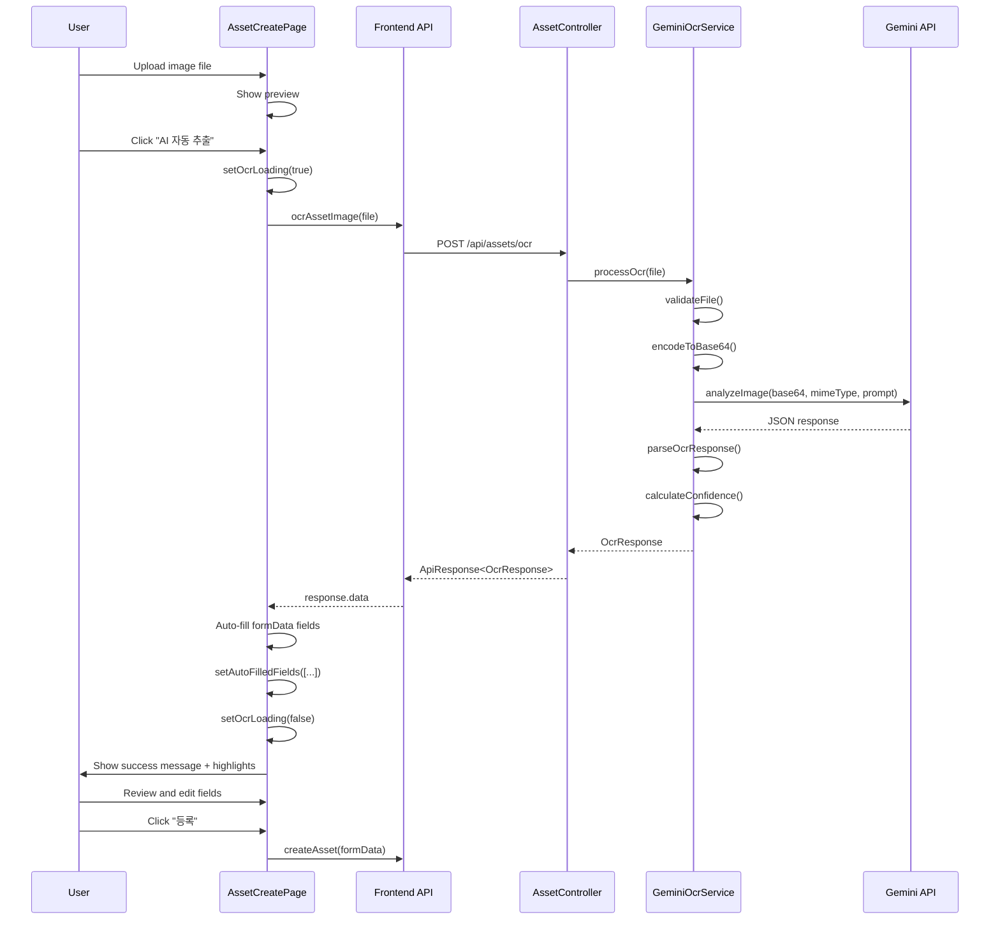

# OCR Integration Implementation Plan
## Asset Registration Flow Enhancement

**Document Version:** 2.0  
**Created:** 2026-02-02  
**Status:** Ready for Implementation  

---

## Executive Summary

This plan details the integration of the existing Gemini OCR service into the asset registration workflow. The OCR service is already functional, but needs to be connected to the asset creation form to provide automated data entry capabilities.

### Current State
- ✅ Working OCR service with Gemini API integration
- ✅ Backend endpoint `/api/assets/ocr` exists
- ✅ File validation and Base64 encoding implemented
- ❌ No frontend integration in asset creation page
- ❌ DTO field mismatch between OCR response and asset form

### Goal
Enable users to upload an asset label/sticker photo during registration, automatically extract information using OCR, and populate the form fields for review and submission.

---

## 1. Gap Analysis

### 1.1 Backend Issues

#### Issue #1: DTO Field Mismatch
**Problem:** [`OcrResponse.java`](src/main/java/org/example/giic_asset/dto/ocr/OcrResponse.java) fields don't align with the OCR prompt or Asset entity.

**Current OcrResponse fields:**
```java
- assetNo
- name
- model
- manufacturer  // ❌ Not in Asset entity
- spec
- confidence
- extractedFields
```

**OCR Prompt actually extracts:**
```
- assetNo
- name
- managing_dept  // ❌ Not in OcrResponse
- purchase_date  // ❌ Not in OcrResponse
- spec
```

**Asset entity fields:**
```java
- assetNo ✅
- name ✅
- model ❌ Not extracted by OCR
- spec ✅
- purchaseDate ❌ Not in OcrResponse (but prompt tries to extract)
- managingDept ❌ Not in OcrResponse (but prompt tries to extract)
- location
- value
- status
- actualUserName
- actualUserDepartment
- actualUserContact
```

**Solution:** Update [`OcrResponse.java`](src/main/java/org/example/giic_asset/dto/ocr/OcrResponse.java) to match what the prompt extracts AND what the Asset form needs.

#### Issue #2: Missing Field Parsing
The [`parseOcrResponse()`](src/main/java/org/example/giic_asset/service/GeminiOcrService.java:130) method tries to parse `manufacturer` and `model`, but the prompt doesn't extract them.

### 1.2 Frontend Issues

#### Issue #1: No OCR Integration
[`AssetCreatePage.js`](src/main/giic_frontend/src/pages/AssetCreatePage.js) has image upload at the bottom, but no OCR trigger or auto-fill logic.

#### Issue #2: Missing API Client Function
[`assets.js`](src/main/giic_frontend/src/api/assets.js) needs an OCR API function.

#### Issue #3: No Visual Feedback
No way to show users which fields were auto-filled vs. manually entered.

---

## 2. Implementation Strategy

### 2.1 Backend Changes

#### Change 1: Update OcrResponse DTO

**File:** [`src/main/java/org/example/giic_asset/dto/ocr/OcrResponse.java`](src/main/java/org/example/giic_asset/dto/ocr/OcrResponse.java)

**Current:**
```java
private String assetNo;
private String name;
private String model;
private String manufacturer;
private String spec;
```

**Updated:**
```java
private String assetNo;          // 자산번호
private String name;             // 물품명
private String managingDept;     // 관리부서 (NEW)
private String purchaseDate;     // 취득일자 (NEW)
private String spec;             // 규격/사양
private Double confidence;
private List<String> extractedFields;
```

**Rationale:** Align with what the OCR prompt actually extracts and what the Asset form needs.

#### Change 2: Update GeminiOcrService Parsing Logic

**File:** [`src/main/java/org/example/giic_asset/service/GeminiOcrService.java`](src/main/java/org/example/giic_asset/service/GeminiOcrService.java:130)

**Update [`parseOcrResponse()`](src/main/java/org/example/giic_asset/service/GeminiOcrService.java:130) method:**

Remove parsing for:
- ❌ `model`
- ❌ `manufacturer`

Add parsing for:
- ✅ `managingDept` (from `managing_dept`)
- ✅ `purchaseDate` (from `purchase_date`)

**Updated code:**
```java
private OcrResponse parseOcrResponse(String jsonResponse) {
    try {
        String cleanedJson = jsonResponse.replace("```json", "").replace("```", "").trim();
        JsonNode rootNode = objectMapper.readTree(cleanedJson);

        OcrResponse.OcrResponseBuilder builder = OcrResponse.builder();
        List<String> extractedFields = new ArrayList<>();

        // Extract assetNo
        String assetNo = getFieldValue(rootNode, "assetNo");
        if (assetNo != null) {
            builder.assetNo(assetNo);
            extractedFields.add("assetNo");
        }

        // Extract name
        String name = getFieldValue(rootNode, "name");
        if (name != null) {
            builder.name(name);
            extractedFields.add("name");
        }

        // Extract managingDept (NEW)
        String managingDept = getFieldValue(rootNode, "managing_dept");
        if (managingDept != null) {
            builder.managingDept(managingDept);
            extractedFields.add("managingDept");
        }

        // Extract purchaseDate (NEW)
        String purchaseDate = getFieldValue(rootNode, "purchase_date");
        if (purchaseDate != null) {
            builder.purchaseDate(purchaseDate);
            extractedFields.add("purchaseDate");
        }

        // Extract spec
        String spec = getFieldValue(rootNode, "spec");
        if (spec != null) {
            builder.spec(spec);
            extractedFields.add("spec");
        }

        builder.extractedFields(extractedFields);
        return builder.build();

    } catch (JsonProcessingException e) {
        log.error("Failed to parse OCR response: {}", jsonResponse, e);
        throw new BaseException(ErrorCode.OCR_PARSING_ERROR);
    }
}
```

#### Change 3: Update Confidence Calculation

**File:** [`src/main/java/org/example/giic_asset/service/GeminiOcrService.java`](src/main/java/org/example/giic_asset/service/GeminiOcrService.java:188)

Update to reflect new fields:

```java
private Double calculateConfidence(OcrResponse response) {
    int totalFields = 5; // assetNo, name, managingDept, purchaseDate, spec
    int extractedCount = response.getExtractedFields().size();

    double baseConfidence = (double) extractedCount / totalFields;

    // Critical fields: assetNo and name
    int criticalFields = 0;
    if (response.getAssetNo() != null) criticalFields++;
    if (response.getName() != null) criticalFields++;

    double criticalWeight = (double) criticalFields / 2 * 0.3;

    return Math.min(baseConfidence + criticalWeight, 1.0);
}
```

### 2.2 Frontend Changes

#### Change 1: Add OCR API Function

**File:** [`src/main/giic_frontend/src/api/assets.js`](src/main/giic_frontend/src/api/assets.js)

**Add after [`uploadAssetImage`](src/main/giic_frontend/src/api/assets.js:58):**

```javascript
export const ocrAssetImage = async (file) => {
    const formData = new FormData();
    formData.append('file', file);

    const response = await client.post('/assets/ocr', formData, {
        headers: {
            'Content-Type': 'multipart/form-data'
        }
    });
    return response.data;
};
```

#### Change 2: Update AssetCreatePage Component

**File:** [`src/main/giic_frontend/src/pages/AssetCreatePage.js`](src/main/giic_frontend/src/pages/AssetCreatePage.js)

**Step 2.1: Add OCR Import**
```javascript
import { createAsset, uploadAssetImage, ocrAssetImage } from '../api/assets';
```

**Step 2.2: Add OCR State**
```javascript
const [loading, setLoading] = useState(false);
const [ocrLoading, setOcrLoading] = useState(false);  // NEW
const [errors, setErrors] = useState({});
const [imageFile, setImageFile] = useState(null);
const [imagePreview, setImagePreview] = useState(null);
const [autoFilledFields, setAutoFilledFields] = useState([]); // NEW
```

**Step 2.3: Add OCR Handler Function**
```javascript
const handleOcrProcess = async () => {
    if (!imageFile) {
        alert('먼저 이미지를 업로드해주세요.');
        return;
    }

    setOcrLoading(true);
    try {
        const response = await ocrAssetImage(imageFile);
        const ocrData = response;

        // Auto-fill form fields from OCR results
        const updatedFields = [];
        const newFormData = { ...formData };

        if (ocrData.assetNo) {
            newFormData.assetNo = ocrData.assetNo;
            updatedFields.push('assetNo');
        }
        if (ocrData.name) {
            newFormData.name = ocrData.name;
            updatedFields.push('name');
        }
        if (ocrData.managingDept) {
            newFormData.managingDept = ocrData.managingDept;
            updatedFields.push('managingDept');
        }
        if (ocrData.purchaseDate) {
            newFormData.purchaseDate = ocrData.purchaseDate;
            updatedFields.push('purchaseDate');
        }
        if (ocrData.spec) {
            newFormData.spec = ocrData.spec;
            updatedFields.push('spec');
        }

        setFormData(newFormData);
        setAutoFilledFields(updatedFields);

        if (updatedFields.length > 0) {
            alert(`✓ OCR 완료: ${updatedFields.length}개 필드가 자동 입력되었습니다.`);
        } else {
            alert('이미지에서 정보를 추출하지 못했습니다. 직접 입력해주세요.');
        }

    } catch (error) {
        console.error('OCR failed:', error);
        const errorMessage = error.response?.data?.error?.message || 
                           'OCR 처리에 실패했습니다. 직접 입력해주세요.';
        alert(errorMessage);
    } finally {
        setOcrLoading(false);
    }
};
```

**Step 2.4: Add Helper Function for Styling**
```javascript
const getInputClassName = (fieldName) => {
    const baseClass = 'form-input';
    return autoFilledFields.includes(fieldName) 
        ? `${baseClass} auto-filled` 
        : baseClass;
};
```

**Step 2.5: Restructure JSX - Move OCR Section to Top**

Place this BEFORE the "기본 정보" section:

```jsx
{/* OCR Section - NEW - Place at top */}
<div className="form-section ocr-section">
    <h3 className="form-section-title">
        📸 이미지 OCR 자동 추출
    </h3>
    <p className="ocr-description">
        자산 라벨이나 명판 사진을 업로드하면 AI가 자동으로 정보를 추출합니다
    </p>
    
    <div className="ocr-upload-container">
        <input
            type="file"
            accept="image/jpeg,image/jpg,image/png,image/webp"
            onChange={handleImageChange}
            className="form-input"
            id="ocr-image-input"
        />
        
        {imagePreview && (
            <div className="ocr-preview-area">
                
                
                <button
                    type="button"
                    className="btn-ocr"
                    onClick={handleOcrProcess}
                    disabled={ocrLoading || !imageFile}
                >
                    {ocrLoading ? (
                        <>
                            <span className="spinner"></span>
                            OCR 처리 중...
                        </>
                    ) : (
                        <>
                            🤖 AI 자동 추출 시작
                        </>
                    )}
                </button>
            </div>
        )}
        
        {!imagePreview && (
            <div className="ocr-placeholder">
                <p>💡 이미지를 업로드하여 자동 입력을 시작하세요</p>
            </div>
        )}
    </div>
    
    {autoFilledFields.length > 0 && (
        <div className="ocr-result-badge">
            ✅ {autoFilledFields.length}개 필드 자동 입력 완료 - 내용을 확인하고 수정하세요
        </div>
    )}
</div>
```

**Step 2.6: Update Form Input Fields**

Update each auto-fillable input to show visual feedback:

```jsx
{/* Example: assetNo field */}
<div className="form-group">
    <label>
        자산번호 <span className="required">*</span>
        {autoFilledFields.includes('assetNo') && (
            <span className="auto-filled-badge">AI 입력</span>
        )}
    </label>
    <input
        type="text"
        name="assetNo"
        className={getInputClassName('assetNo')}
        value={formData.assetNo}
        onChange={handleChange}
    />
    {errors.assetNo && <span className="error-message">{errors.assetNo}</span>}
</div>

{/* Apply same pattern to: name, managingDept, purchaseDate, spec */}
```

#### Change 3: Add CSS Styles

**File:** [`src/main/giic_frontend/src/styles/Asset.css`](src/main/giic_frontend/src/styles/Asset.css)

**Add at the end:**

```css
/* ========================================
   OCR Section Styles
   ======================================== */

.ocr-section {
    background: linear-gradient(135deg, #667eea 0%, #764ba2 100%);
    color: white;
    border-radius: 12px;
    padding: 24px;
    margin-bottom: 32px;
    box-shadow: 0 4px 16px rgba(102, 126, 234, 0.3);
}

.ocr-section .form-section-title {
    color: white;
    margin-bottom: 8px;
    font-size: 20px;
}

.ocr-description {
    color: rgba(255, 255, 255, 0.9);
    font-size: 14px;
    margin-bottom: 20px;
}

.ocr-upload-container {
    background: rgba(255, 255, 255, 0.1);
    border: 2px dashed rgba(255, 255, 255, 0.4);
    border-radius: 8px;
    padding: 20px;
}

.ocr-preview-area {
    display: flex;
    flex-direction: column;
    align-items: center;
    gap: 16px;
    margin-top: 16px;
}

.ocr-image-preview {
    max-width: 100%;
    max-height: 400px;
    border-radius: 8px;
    box-shadow: 0 4px 12px rgba(0, 0, 0, 0.3);
}

.btn-ocr {
    background: white;
    color: #667eea;
    border: none;
    padding: 14px 32px;
    border-radius: 8px;
    font-size: 16px;
    font-weight: 600;
    cursor: pointer;
    display: inline-flex;
    align-items: center;
    gap: 8px;
    transition: all 0.3s ease;
    box-shadow: 0 2px 8px rgba(0, 0, 0, 0.2);
}

.btn-ocr:hover:not(:disabled) {
    transform: translateY(-2px);
    box-shadow: 0 6px 16px rgba(0, 0, 0, 0.3);
}

.btn-ocr:disabled {
    opacity: 0.6;
    cursor: not-allowed;
}

.spinner {
    width: 16px;
    height: 16px;
    border: 2px solid rgba(102, 126, 234, 0.3);
    border-top-color: #667eea;
    border-radius: 50%;
    animation: spin 0.8s linear infinite;
}

@keyframes spin {
    to { transform: rotate(360deg); }
}

.ocr-placeholder {
    padding: 60px 20px;
    text-align: center;
    color: rgba(255, 255, 255, 0.8);
    font-size: 14px;
}

.ocr-result-badge {
    margin-top: 16px;
    padding: 12px 16px;
    background: rgba(255, 255, 255, 0.15);
    border-radius: 6px;
    font-size: 14px;
    text-align: center;
    backdrop-filter: blur(10px);
}

/* Auto-filled field highlighting */
.form-input.auto-filled {
    border: 2px solid #667eea;
    background-color: #f0f4ff;
    box-shadow: 0 0 0 3px rgba(102, 126, 234, 0.1);
}

.auto-filled-badge {
    margin-left: 8px;
    background: #667eea;
    color: white;
    padding: 3px 10px;
    border-radius: 12px;
    font-size: 11px;
    font-weight: 600;
    text-transform: uppercase;
}

/* Responsive adjustments */
@media (max-width: 768px) {
    .ocr-section {
        padding: 16px;
    }
    
    .btn-ocr {
        width: 100%;
        justify-content: center;
    }
}
```

---

## 3. Data Flow Diagram



---

## 4. Field Mapping Reference

| OCR Response Field | Asset Form Field | Required? | Auto-fillable? |
|-------------------|------------------|-----------|----------------|
| `assetNo` | `assetNo` | ✅ Yes | ✅ Yes |
| `name` | `name` | ✅ Yes | ✅ Yes |
| `managingDept` | `managingDept` | ✅ Yes | ✅ Yes |
| `purchaseDate` | `purchaseDate` | ✅ Yes | ✅ Yes |
| `spec` | `spec` | ❌ No | ✅ Yes |
| - | `model` | ✅ Yes | ❌ No (manual) |
| - | `value` | ❌ No | ❌ No (manual) |
| - | `location` | ❌ No | ❌ No (manual) |
| - | `status` | ✅ Yes | ❌ No (default: NORMAL) |
| - | `actualUserName` | ❌ No | ❌ No (manual) |
| - | `actualUserDepartment` | ❌ No | ❌ No (manual) |
| - | `actualUserContact` | ❌ No | ❌ No (manual) |

**Expected Auto-fill Rate:** 3-5 fields (assetNo, name, managingDept, purchaseDate, spec)  
**Manual Entry Required:** model, value, location, actual user information

---

## 5. Error Handling Strategy

### 5.1 Backend Error Scenarios

| Error Scenario | Error Code | HTTP Status | User Message |
|---------------|------------|-------------|--------------|
| File not uploaded | BAD_REQUEST | 400 | "파일이 비어있습니다." |
| File too large (>10MB) | IMAGE_TOO_LARGE | 400 | "파일 크기는 10MB를 초과할 수 없습니다." |
| Invalid file format | INVALID_IMAGE_FORMAT | 400 | "지원하지 않는 이미지 형식입니다." |
| Gemini API failure | EXTERNAL_API_ERROR | 503 | "OCR 서비스에 일시적인 문제가 발생했습니다." |
| JSON parsing error | OCR_PARSING_ERROR | 500 | "OCR 결과 처리 중 오류가 발생했습니다." |

### 5.2 Frontend Error Handling

```javascript
catch (error) {
    console.error('OCR failed:', error);
    
    if (error.response?.status === 400) {
        alert('이미지 파일을 확인해주세요. (JPG, PNG, WEBP만 지원, 최대 10MB)');
    } else if (error.response?.status === 503) {
        alert('OCR 서비스가 일시적으로 사용 불가합니다. 잠시 후 다시 시도하거나 직접 입력해주세요.');
    } else {
        alert('OCR 처리에 실패했습니다. 직접 입력해주세요.');
    }
}
```

### 5.3 Graceful Degradation

If OCR fails, the user can still:
1. Manually fill all form fields
2. Upload the image as asset documentation (saved after asset creation)
3. Complete the registration process normally

**Key Principle:** OCR is an enhancement, not a requirement. The system must work with or without it.

---

## 6. Testing Plan

### 6.1 Backend Unit Tests

**Update:** [`src/test/java/org/example/giic_asset/service/GeminiOcrServiceTest.java`](src/test/java/org/example/giic_asset/service/GeminiOcrServiceTest.java)

```java
@Test
void testParseOcrResponse_AllFieldsExtracted() {
    // Test with response containing all fields
    String jsonResponse = """
        {
            "assetNo": "GIIC-2024-001",
            "name": "노트북",
            "managing_dept": "IT부서",
            "purchase_date": "2024-01-15",
            "spec": "Intel i7, 16GB RAM"
        }
        """;
    
    OcrResponse response = geminiOcrService.parseOcrResponse(jsonResponse);
    
    assertEquals("GIIC-2024-001", response.getAssetNo());
    assertEquals("노트북", response.getName());
    assertEquals("IT부서", response.getManagingDept());
    assertEquals("2024-01-15", response.getPurchaseDate());
    assertEquals("Intel i7, 16GB RAM", response.getSpec());
    assertEquals(5, response.getExtractedFields().size());
}

@Test
void testParseOcrResponse_PartialFields() {
    // Test with only some fields extracted
    String jsonResponse = """
        {
            "assetNo": "GIIC-2024-001",
            "name": "노트북",
            "managing_dept": null,
            "purchase_date": null,
            "spec": null
        }
        """;
    
    OcrResponse response = geminiOcrService.parseOcrResponse(jsonResponse);
    
    assertEquals("GIIC-2024-001", response.getAssetNo());
    assertEquals("노트북", response.getName());
    assertNull(response.getManagingDept());
    assertNull(response.getPurchaseDate());
    assertEquals(2, response.getExtractedFields().size());
}
```

### 6.2 Integration Tests

**Manual Test Scenarios:**

1. **Happy Path:**
   - [ ] Upload clear asset label image (JPG, 2MB)
   - [ ] Click OCR button
   - [ ] Verify 3+ fields auto-filled
   - [ ] Verify fields highlighted
   - [ ] Verify "AI 입력" badge shown
   - [ ] Edit auto-filled values
   - [ ] Submit form successfully

2. **Edge Cases:**
   - [ ] Upload 9.9MB image (should succeed)
   - [ ] Upload 10.1MB image (should fail with message)
   - [ ] Upload PNG, WEBP formats (should work)
   - [ ] Upload PDF or GIF (should fail with format error)
   - [ ] Upload image with no text (should return empty response)
   - [ ] Upload blurry image (low confidence score)

3. **Error Recovery:**
   - [ ] Simulate network failure during OCR
   - [ ] Verify error message shown
   - [ ] Verify user can still manually enter data
   - [ ] Verify form submission still works

### 6.3 Acceptance Criteria

- ✅ User can upload image before filling form
- ✅ OCR button appears after image upload
- ✅ Loading indicator shown during processing
- ✅ At least 2 fields auto-filled for clear images
- ✅ Auto-filled fields visually highlighted
- ✅ User can edit auto-filled values
- ✅ Errors show user-friendly messages
- ✅ Form works with or without OCR
- ✅ Image saved as asset documentation after registration

---

## 7. Implementation Checklist

### Phase 1: Backend Updates (Priority: HIGH)

- [ ] **OcrResponse.java**
  - [ ] Remove `model` and `manufacturer` fields
  - [ ] Add `managingDept` field
  - [ ] Add `purchaseDate` field
  - [ ] Update Lombok builder

- [ ] **GeminiOcrService.java**
  - [ ] Update [`parseOcrResponse()`](src/main/java/org/example/giic_asset/service/GeminiOcrService.java:130) to extract `managing_dept`
  - [ ] Update [`parseOcrResponse()`](src/main/java/org/example/giic_asset/service/GeminiOcrService.java:130) to extract `purchase_date`
  - [ ] Remove parsing for `model` and `manufacturer`
  - [ ] Update [`calculateConfidence()`](src/main/java/org/example/giic_asset/service/GeminiOcrService.java:188) logic

- [ ] **Testing**
  - [ ] Update [`GeminiOcrServiceTest.java`](src/test/java/org/example/giic_asset/service/GeminiOcrServiceTest.java)
  - [ ] Test with real image samples
  - [ ] Verify `/api/assets/ocr` endpoint returns correct format

### Phase 2: Frontend API Layer (Priority: HIGH)

- [ ] **assets.js**
  - [ ] Add `ocrAssetImage(file)` function
  - [ ] Test API call manually (Postman/curl)

### Phase 3: Frontend UI Integration (Priority: HIGH)

- [ ] **AssetCreatePage.js**
  - [ ] Import `ocrAssetImage` from API
  - [ ] Add `ocrLoading` state
  - [ ] Add `autoFilledFields` state
  - [ ] Implement `handleOcrProcess()` function
  - [ ] Implement `getInputClassName()` helper
  - [ ] Move image upload section to top
  - [ ] Add OCR button and loading indicator
  - [ ] Add OCR result badge
  - [ ] Update all auto-fillable input fields with highlighting

- [ ] **Asset.css**
  - [ ] Add `.ocr-section` styles
  - [ ] Add `.btn-ocr` styles
  - [ ] Add `.spinner` animation
  - [ ] Add `.auto-filled` input styles
  - [ ] Add `.auto-filled-badge` styles
  - [ ] Test responsive layout

### Phase 4: Testing & Validation (Priority: MEDIUM)

- [ ] Backend unit tests pass
- [ ] OCR endpoint returns correct DTO structure
- [ ] Frontend displays OCR section correctly
- [ ] Auto-fill logic works for all fields
- [ ] Visual highlighting works
- [ ] Error messages display correctly
- [ ] Form submission works with auto-filled data
- [ ] Test with various image types and qualities

### Phase 5: Documentation (Priority: LOW)

- [ ] Update API documentation
- [ ] Add user guide for OCR feature
- [ ] Document troubleshooting steps
- [ ] Update README with OCR capabilities

---

## 8. Rollback Plan

If critical issues arise after deployment:

1. **Immediate:** Frontend-only rollback
   - Remove OCR section from [`AssetCreatePage.js`](src/main/giic_frontend/src/pages/AssetCreatePage.js)
   - Revert to manual-only data entry
   - Backend endpoint remains (no breaking changes)

2. **If needed:** Backend rollback
   - Revert [`OcrResponse.java`](src/main/java/org/example/giic_asset/dto/ocr/OcrResponse.java) to original version
   - Revert [`GeminiOcrService.java`](src/main/java/org/example/giic_asset/service/GeminiOcrService.java) parsing logic
   - Frontend OCR calls will fail gracefully

3. **Recovery:**
   - Users can continue registering assets manually
   - No data loss occurs
   - Fix issues and redeploy

---

## 9. Performance Considerations

### 9.1 Expected Latency

- **Image upload:** < 1 second (dependent on file size)
- **OCR processing:** 2-5 seconds (Gemini API call + parsing)
- **Total user wait time:** 3-6 seconds

### 9.2 Optimization Opportunities

1. **Image compression (Future):** Resize images to max 1920x1080 before upload
2. **Caching (Future):** Cache OCR results by image hash to prevent duplicate processing
3. **Async processing (Future):** WebSocket for long-running OCR jobs

### 9.3 Rate Limiting

- Current: No rate limiting (rely on Gemini API limits)
- Future: Implement user-based rate limiting (e.g., 10 OCR calls per hour)

---

## 10. Security Checklist

- ✅ API key stored in environment variable (not in code)
- ✅ File type validation (whitelist: JPG, PNG, WEBP)
- ✅ File size validation (max 10MB)
- ✅ MIME type verification
- ✅ Image data not persisted on server (processed in memory)
- ✅ No sensitive data logged
- ✅ Error messages don't expose internal details
- ⚠️ Consider: CSRF protection for OCR endpoint (already handled by existing Spring Security)

---

## 11. Success Metrics

### 11.1 Technical Metrics

- **OCR Success Rate:** > 80% (at least 2 fields extracted)
- **Average Processing Time:** < 5 seconds
- **Error Rate:** < 5%
- **User Adoption:** > 60% of asset registrations use OCR within 1 month

### 11.2 User Experience Metrics

- **Time Savings:** 50% reduction in form completion time
- **Data Accuracy:** Fewer typos in assetNo and name fields
- **User Satisfaction:** Collect feedback after 2 weeks

---

## 12. Future Enhancements

### Short-term (1-2 months)
1. Add confidence indicator per field (show which fields are more/less certain)
2. Add "Retry OCR" button without re-uploading
3. Support for QR code / barcode detection

### Long-term (3-6 months)
1. Batch OCR for multiple assets
2. Mobile camera integration (PWA)
3. Custom prompt tuning based on organization's label formats
4. ML model fine-tuning on user corrections

---

## Appendix A: Example OCR Response

**Input Image:** Laptop asset label  
**Expected OCR Response:**

```json
{
  "success": true,
  "data": {
    "assetNo": "GIIC-2024-0125",
    "name": "노트북",
    "managingDept": "정보기술부",
    "purchaseDate": "2024-01-15",
    "spec": "Intel Core i7-1355U, 16GB RAM, 512GB SSD, Windows 11 Pro",
    "confidence": 0.92,
    "extractedFields": ["assetNo", "name", "managingDept", "purchaseDate", "spec"]
  },
  "message": "OCR 처리가 완료되었습니다."
}
```

---

## Appendix B: File Structure Reference

```
src/
├── main/
│   ├── java/org/example/giic_asset/
│   │   ├── controller/
│   │   │   └── AssetController.java          ← OCR endpoint exists
│   │   ├── service/
│   │   │   └── GeminiOcrService.java         ← Update parsing logic
│   │   ├── client/
│   │   │   └── GeminiApiClient.java          ← Already implemented
│   │   └── dto/
│   │       └── ocr/
│   │           └── OcrResponse.java          ← Update fields
│   └── giic_frontend/src/
│       ├── pages/
│       │   └── AssetCreatePage.js           ← Add OCR integration
│       ├── api/
│       │   └── assets.js                    ← Add ocrAssetImage()
│       └── styles/
│           └── Asset.css                    ← Add OCR styles
└── test/
    └── java/org/example/giic_asset/
        └── service/
            └── GeminiOcrServiceTest.java    ← Update tests
```

---

## Conclusion

This plan provides a complete roadmap for integrating the existing OCR service into the asset registration workflow. The implementation focuses on:

1. **Backend:** Aligning DTO fields with actual OCR extraction
2. **Frontend:** Adding seamless OCR trigger and auto-fill UX
3. **UX:** Visual feedback for auto-filled fields
4. **Reliability:** Graceful error handling and fallback to manual entry

The integration is designed to be **non-breaking** and **optional** - users can still register assets manually if OCR fails or is unavailable.

**Estimated Implementation Time:** 2-3 days for a single developer  
**Risk Level:** Low (OCR is enhancement, not dependency)  
**User Impact:** High (significant time savings and improved data accuracy)

---

**Document prepared by:** AI Architect  
**Review status:** Ready for developer implementation  
**Last updated:** 2026-02-02
