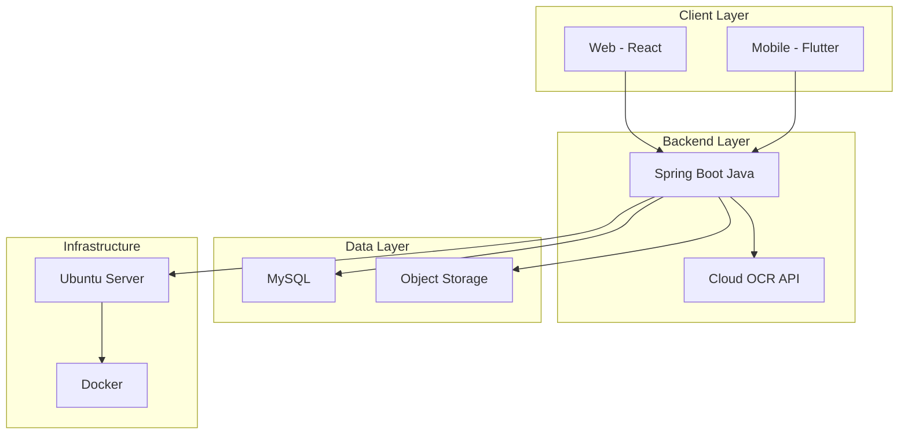
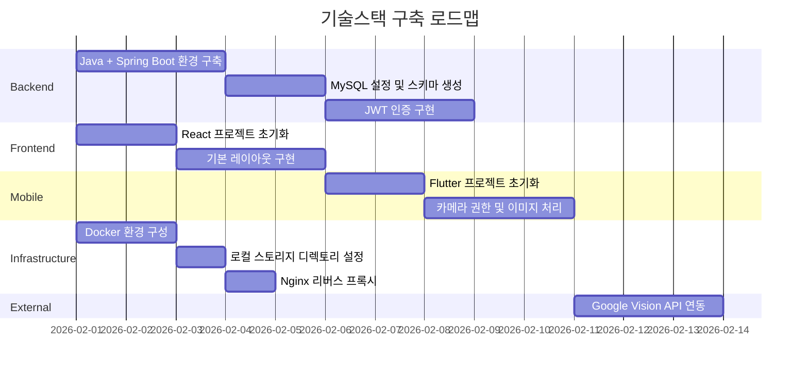
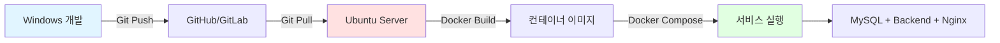

# 자산관리 시스템 기술스택 검토 및 권장사항

## 📋 문서 개요

본 문서는 경남대학교 자산관리 시스템의 현재 정의된 기술스택을 검토하고, 각 레이어별 대안과 권장사항을 제시합니다.

---

## 1. 현재 정의된 기술스택

### 1.1 전체 구성



### 1.2 레이어별 현재 스택

| 레이어 | 기술 | 버전/사양 |
|--------|------|-----------|
| **Backend** | Spring Boot (Java) | 미정 (권장: Java 17+, Spring Boot 3.x) |
| **Frontend (Web)** | React | 미정 |
| **Frontend (Mobile)** | Flutter | 미정 |
| **Database** | MySQL | 미정 (권장: 8.0+) |
| **Storage** | Local File System | 서버 로컬 스토리지 (Docker 볼륨) |
| **OCR** | Google Cloud Vision API | GCP 사업단 계정 활용 |
| **개발 환경** | Windows | - |
| **배포 환경** | Ubuntu + Docker | - |
| **Infrastructure** | Ubuntu + Docker | 미정 |
| **Authentication** | JWT | - |

---

## 2. Backend 레이어 검토

### 2.1 현재: Spring Boot (Java)

#### ✅ 장점
- **성숙도**: 엔터프라이즈급 프레임워크, 검증된 안정성
- **생태계**: 방대한 라이브러리 및 커뮤니티
- **대학 환경**: 많은 대학에서 사용, 유지보수 인력 확보 용이
- **타입 안정성**: Java의 강타입 시스템으로 안전한 코드 작성
- **JPA/Hibernate**: 강력한 ORM 지원
- **Spring Security**: 검증된 보안 프레임워크

#### ⚠️ 단점
- **학습 곡선**: 초기 진입장벽이 높음
- **보일러플레이트**: 설정 코드가 많음 (최근 개선되고 있음)
- **메모리 사용량**: JVM 기반으로 메모리 사용량이 다소 높음
- **빌드 시간**: 대규모 프로젝트 시 빌드 시간 증가

### 2.2 대안 1: Node.js + Express/NestJS

#### ✅ 장점
- **개발 속도**: 빠른 프로토타이핑
- **JavaScript 통일**: 프론트엔드와 같은 언어 사용
- **가벼움**: 메모리 사용량 적음
- **NestJS**: TypeScript + DI 패턴으로 Spring과 유사한 구조

#### ⚠️ 단점
- **타입 안정성**: JavaScript는 약타입 (TypeScript로 보완 가능)
- **성능**: CPU 집약적 작업에서 Java보다 낮은 성능
- **엔터프라이즈 경험**: Spring 대비 대규모 시스템 사례 적음

### 2.3 대안 2: Python + FastAPI/Django

#### ✅ 장점
- **간결함**: Python의 간결한 문법
- **데이터 분석**: OCR/AI 연동 시 강점
- **FastAPI**: 현대적인 API 프레임워크, 빠른 성능
- **Django**: Full-stack 프레임워크, Admin 패널 제공

#### ⚠️ 단점
- **성능**: Java보다 낮은 처리 속도
- **타입 안정성**: 동적 타입 (Type Hints로 보완 가능)
- **배포**: 의존성 관리 복잡도

### 2.4 **권장사항: Spring Boot 유지** ✅

#### 이유
1. **대학 환경 적합성**: 유지보수 인력 확보 용이
2. **안정성**: 장기 운영에 검증된 프레임워크
3. **보안**: Spring Security로 강력한 인증/권한 관리
4. **확장성**: 향후 기능 확장 시 풍부한 생태계 활용

#### 구체적 권장 버전
```
- Java: 17 LTS (2029년까지 지원)
- Spring Boot: 3.2.x (최신 안정 버전)
- Spring Security: 6.x
- Spring Data JPA: 3.x
```

---

## 3. Frontend 레이어 검토

### 3.1 현재: React (Web)

#### ✅ 장점
- **생태계**: 가장 큰 커뮤니티 및 라이브러리
- **유연성**: 다양한 아키텍처 구성 가능
- **채용**: 개발자 풀이 가장 큼
- **성능**: Virtual DOM으로 효율적 렌더링

#### ⚠️ 단점
- **설정 복잡도**: 초기 설정이 다소 복잡
- **빠른 변화**: 생태계 변화가 빠름

### 3.2 대안 1: Vue.js

#### ✅ 장점
- **학습 곡선**: React보다 쉬움
- **공식 생태계**: Vuex, Vue Router 등 공식 라이브러리
- **한국어 자료**: 한국 커뮤니티 활발

#### ⚠️ 단점
- **생태계 크기**: React보다 작음
- **채용**: React 개발자가 더 많음

### 3.3 대안 2: Next.js (React 기반)

#### ✅ 장점
- **SSR/SSG**: 서버 사이드 렌더링 지원
- **SEO**: 검색엔진 최적화 용이
- **통합 라우팅**: 파일 기반 라우팅
- **성능**: 자동 최적화

#### ⚠️ 단점
- **복잡도**: 순수 React보다 학습량 증가
- **Overkill**: 내부 시스템에는 과할 수 있음

### 3.4 **권장사항: React 유지 (또는 Next.js 검토)** ✅

#### React 단독 추천 시나리오
- **내부 시스템**: SEO 불필요, 인증 사용자만 접근
- **빠른 개발**: Create React App 또는 Vite 활용
- **학습 용이성**: 대학 환경에서 교육 용이

#### Next.js 추천 시나리오
- **향후 확장**: 외부 공개 페이지 가능성
- **성능 중시**: SSR로 초기 로딩 속도 개선
- **현대적 스택**: 최신 기술 도입 의지

#### 구체적 권장
```
Option 1 (내부 시스템):
- React 18.x + Vite
- React Router 6.x
- TanStack Query (React Query)
- Zustand (상태관리)

Option 2 (확장 가능성):
- Next.js 14+ (App Router)
- Built-in Routing
- Server Components
```

### 3.5 현재: Flutter (Mobile)

#### ✅ 장점
- **크로스 플랫폼**: iOS + Android 동시 개발
- **성능**: Native에 가까운 성능
- **UI 일관성**: 플랫폼 간 동일한 UI
- **Hot Reload**: 빠른 개발 피드백

#### ⚠️ 단점
- **앱 크기**: Native보다 큼
- **학습 곡선**: Dart 언어 학습 필요
- **생태계**: React Native보다 작음

### 3.6 대안: React Native

#### ✅ 장점
- **JavaScript 통일**: 웹과 같은 언어
- **큰 생태계**: 더 많은 라이브러리
- **개발자 풀**: 더 많은 인력

#### ⚠️ 단점
- **성능**: Flutter보다 낮음
- **UI 차이**: 플랫폼별 차이 존재

### 3.7 **권장사항: Flutter 유지** ✅

#### 이유
1. **성능**: 자산 이미지 촬영/처리에 유리
2. **UI 일관성**: iOS/Android 동일 경험
3. **OCR 연동**: 카메라 접근 및 이미지 처리 강점
4. **단일 코드베이스**: 유지보수 효율

---

## 4. Database 레이어 검토

### 4.1 현재: MySQL

#### ✅ 장점
- **성숙도**: 가장 널리 사용되는 RDBMS
- **안정성**: 검증된 신뢰성
- **커뮤니티**: 방대한 자료 및 지원
- **무료**: 오픈소스 (GPL)
- **Spring 통합**: JPA/MyBatis 완벽 지원

#### ⚠️ 단점
- **JSON 지원**: PostgreSQL보다 약함
- **전문 검색**: Elasticsearch보다 제한적

### 4.2 대안 1: PostgreSQL

#### ✅ 장점
- **JSON 지원**: JSONB 타입으로 강력한 JSON 처리
- **확장성**: Extension 시스템
- **Full-text Search**: 내장 전문 검색
- **표준 준수**: SQL 표준 엄격 준수

#### ⚠️ 단점
- **학습 곡선**: MySQL보다 다소 복잡
- **한국 커뮤니티**: MySQL보다 작음

### 4.3 대안 2: MariaDB

#### ✅ 장점
- **MySQL 호환**: 마이그레이션 용이
- **성능**: MySQL보다 개선된 부분 존재
- **오픈소스**: 완전 오픈소스

#### ⚠️ 단점
- **생태계**: MySQL보다 작음

### 4.4 **권장사항: MySQL 8.0+ 유지** ✅

#### 이유
1. **대학 환경**: 가장 익숙한 DB
2. **안정성**: 장기 운영 검증
3. **단순 구조**: JSON 등 고급 기능 불필요
4. **교육**: 학생 교육 및 유지보수 용이

#### 구체적 권장
```
- MySQL: 8.0.x (최신 LTS)
- Character Set: utf8mb4
- Collation: utf8mb4_unicode_ci
- Storage Engine: InnoDB
```

#### PostgreSQL 검토 시나리오
- 향후 복잡한 검색 기능 추가 시
- JSON 데이터 대량 처리 시
- 지리정보(PostGIS) 필요 시

---

## 5. Storage 레이어 검토

### 5.1 Object Storage 옵션

#### Option 1: AWS S3
**✅ 장점**
- 업계 표준, 최고 안정성
- 99.999999999% 내구성
- CDN(CloudFront) 통합

**⚠️ 단점**
- 비용 (트래픽 기준)
- AWS 계정 및 결제 필요

#### Option 2: Naver Cloud Object Storage
**✅ 장점**
- 한국 리전 (빠른 속도)
- 한국어 지원
- S3 호환 API

**⚠️ 단점**
- AWS보다 생태계 작음

#### Option 3: MinIO (자체 구축)
**✅ 장점**
- 완전 무료
- S3 호환 API
- Docker로 쉬운 구축
- 데이터 주권 확보

**⚠️ 단점**
- 직접 관리 필요
- 백업/복구 책임

#### Option 4: Local File System ✅ **선택됨**
**✅ 장점**
- 가장 단순하고 빠른 구현
- 추가 비용 없음
- Docker 볼륨으로 데이터 영속성 보장
- 백업 스크립트로 간단히 관리

**⚠️ 단점**
- 수평 확장 제한 (단일 서버)
- 서버 이전 시 데이터 마이그레이션 필요

**🔧 구현 방식**
```java
// application.yml
spring:
  servlet:
    multipart:
      max-file-size: 10MB
      max-request-size: 10MB
      location: /app/uploads  # Docker 컨테이너 내 경로

file:
  upload-dir: /app/uploads/assets
  allowed-extensions: jpg,jpeg,png,pdf
```

```yaml
# docker-compose.yml
services:
  app:
    volumes:
      - ./uploads:/app/uploads  # 호스트 → 컨테이너 마운트
```

**📁 디렉토리 구조**
```
/app/uploads/
├── assets/           # 자산 이미지
│   ├── 2501518/
│   │   ├── main.jpg
│   │   └── detail_1.jpg
│   └── 2501519/
└── temp/            # OCR 임시 파일
```

### 5.2 **권장사항: Local File System** ✅

#### 선택 이유
1. **사업단 요구사항**: 로컬 스토리지 사용 지시
2. **단순성**: 별도 스토리지 서비스 불필요
3. **비용**: 완전 무료
4. **충분한 성능**: 내부 시스템으로 트래픽 낮음

#### 운영 전략
```
백업:
- 일일 자동 백업 (rsync, cron)
- 외부 저장소 동기화 (선택)

보안:
- 업로드 파일 검증 (크기, 확장자)
- 디렉토리 접근 권한 제한
- Nginx로 정적 파일 서빙

모니터링:
- 디스크 사용량 알림
- 정기적 정리 (임시 파일)
```

#### 향후 확장 옵션
- Phase 2: MinIO 도입 (S3 호환)
- Phase 3: 클라우드 스토리지 이전

---

## 6. OCR 서비스 검토

### 6.1 OCR API 옵션

#### Option 1: Google Cloud Vision API
**✅ 장점**
- 최고 수준 정확도
- 다국어 지원 우수
- 강력한 문서 OCR

**⚠️ 단점**
- 비용 (요청당 과금)
- Google 계정 필요

**비용**
- 월 1,000건 무료
- 이후 건당 $1.50/1,000건

#### Option 2: AWS Textract
**✅ 장점**
- 테이블/양식 인식 우수
- AWS 생태계 통합

**⚠️ 단점**
- 한국어 지원 제한적
- 비용

#### Option 3: Naver Clova OCR
**✅ 장점**
- 한국어 최적화
- 한국 문서 형식 강점
- 한국어 지원

**⚠️ 단점**
- 글로벌 확장 시 제한

**비용**
- 월 1,000건 무료
- 이후 건당 20원

#### Option 4: Tesseract (오픈소스)
**✅ 장점**
- 완전 무료
- 자체 서버 구축
- 데이터 외부 유출 없음

**⚠️ 단점**
- 정확도 낮음
- 자체 학습 필요
- 유지보수 부담

### 6.2 **권장사항: Google Cloud Vision API** ✅ **선택됨**

#### 선택 이유
1. **GCP 계정 보유**: 사업단에서 이미 GCP 계정 운영 중
2. **최고 정확도**: 업계 최고 수준의 OCR 성능
3. **다국어 지원**: 한국어 포함 우수한 다국어 인식
4. **무료 티어**: 월 1,000건 무료
5. **통합 관리**: 기존 GCP 인프라와 통합

#### 구현 방법
```java
// build.gradle
dependencies {
    implementation 'com.google.cloud:google-cloud-vision:3.x.x'
}

// application.yml
google:
  cloud:
    vision:
      credentials: classpath:gcp-service-account.json
      project-id: your-project-id
```

```java
// OCR Service 예시
@Service
public class OcrService {
    @Autowired
    private ImageAnnotatorClient visionClient;
    
    public OcrResult processImage(byte[] imageBytes) {
        Image img = Image.newBuilder()
            .setContent(ByteString.copyFrom(imageBytes))
            .build();
        
        Feature feat = Feature.newBuilder()
            .setType(Feature.Type.TEXT_DETECTION)
            .build();
        
        AnnotateImageRequest request = AnnotateImageRequest.newBuilder()
            .addFeatures(feat)
            .setImage(img)
            .build();
        
        // Vision API 호출 및 결과 파싱
        BatchAnnotateImagesResponse response =
            visionClient.batchAnnotateImages(List.of(request));
        
        return parseOcrResult(response);
    }
}
```

#### 예상 비용 (월간)
```
무료 티어:
- 월 1,000건 무료

예상 사용량: 월 500건 (평균)
- 비용: 0원 (무료 범위 내)

확장 시: 월 5,000건
- 무료: 1,000건
- 유료: 4,000건 × $1.50/1,000건 = $6 (약 8,000원)
```

#### 보안 설정
```
1. Service Account Key 관리
   - JSON 키 파일 안전 보관
   - 환경 변수로 주입 (코드에 하드코딩 금지)
   
2. IAM 권한 최소화
   - Vision API User 권한만 부여
   
3. API 키 보호
   - .gitignore에 키 파일 추가
   - Docker secrets 활용
```

---

## 7. Infrastructure 레이어 검토

### 7.1 현재: Ubuntu + Docker

#### ✅ 장점
- **표준화**: 업계 표준
- **격리**: 컨테이너 격리로 안전성
- **이식성**: 환경 독립적 배포
- **확장성**: 쉬운 수평 확장

#### ⚠️ 단점
- **학습 곡선**: Docker 학습 필요
- **오버헤드**: 미미한 성능 오버헤드

### 7.2 **권장사항: Ubuntu 20.04/22.04 LTS + Docker Compose** ✅

#### 이유
1. **안정성**: LTS 버전 장기 지원
2. **단순성**: 단일 서버로 충분
3. **관리 용이**: Docker Compose로 통합 관리

#### 구체적 구성
```yaml
# docker-compose.yml
version: '3.8'

services:
  app:
    build: .
    image: asset-management-backend:latest
    ports:
      - "8080:8080"
    environment:
      - SPRING_PROFILES_ACTIVE=prod
      - GOOGLE_APPLICATION_CREDENTIALS=/app/secrets/gcp-key.json
    volumes:
      - ./uploads:/app/uploads           # 로컬 스토리지
      - ./gcp-key.json:/app/secrets/gcp-key.json:ro  # GCP 키
    depends_on:
      - db
    restart: unless-stopped
  
  db:
    image: mysql:8.0
    volumes:
      - mysql-data:/var/lib/mysql
    environment:
      - MYSQL_ROOT_PASSWORD=${DB_PASSWORD}
      - MYSQL_DATABASE=asset_management
      - TZ=Asia/Seoul
    restart: unless-stopped
  
  nginx:
    image: nginx:alpine
    ports:
      - "80:80"
      - "443:443"
    volumes:
      - ./nginx.conf:/etc/nginx/nginx.conf
      - ./ssl:/etc/nginx/ssl
      - ./uploads:/var/www/uploads:ro    # 정적 파일 서빙
    depends_on:
      - app
    restart: unless-stopped

volumes:
  mysql-data:
```

### 7.3 향후 확장 옵션

#### Option 1: Kubernetes (대규모 확장 시)
- 자동 스케일링
- 무중단 배포
- 서비스 메시

#### Option 2: 서버리스 (AWS Lambda, Cloud Functions)
- 비용 최적화
- 자동 확장
- 관리 부담 감소

---

## 8. Authentication & Security

### 8.1 현재: JWT

#### ✅ 장점
- **Stateless**: 서버 세션 불필요
- **확장성**: 수평 확장 용이
- **모바일 친화적**: 토큰 저장 간편

#### ⚠️ 단점
- **토큰 취소**: 로그아웃 시 즉시 무효화 어려움
- **크기**: 세션보다 큼

### 8.2 **권장사항: JWT + Refresh Token 패턴** ✅

#### 구성
```
Access Token:
- 유효기간: 15분
- 용도: API 인증

Refresh Token:
- 유효기간: 7일
- 용도: Access Token 재발급
- 저장: DB에 저장 (취소 가능)
```

#### 추가 보안 강화
```
1. HTTPS 필수
2. HttpOnly Cookie (XSS 방어)
3. CSRF Token
4. Rate Limiting
5. 비밀번호 정책 (8자 이상, 복잡도)
6. BCrypt 해싱 (cost factor 10+)
```

---

## 9. 최종 권장 기술스택

### 9.1 **Phase 1: MVP (최소 기능 제품)** 🎯

```
개발 환경:
├─ OS: Windows 11
├─ IDE: IntelliJ IDEA / VS Code
├─ Java 17 + Gradle
├─ Node.js 18+ (React)
├─ Flutter SDK 3.x
└─ Git

Backend:
├─ Java 17
├─ Spring Boot 3.2.x
├─ Spring Security 6.x
├─ Spring Data JPA
├─ MySQL 8.0 (Docker Desktop)
├─ JWT Authentication
└─ Google Cloud Vision API SDK

Frontend (Web):
├─ React 18.x
├─ Vite (빌드 도구)
├─ React Router 6.x
├─ TanStack Query
└─ Axios

Frontend (Mobile):
├─ Flutter 3.x
└─ Dart 3.x

Storage & External:
├─ Local File System (Docker 볼륨)
└─ Google Cloud Vision API (GCP 계정)

배포 Infrastructure:
├─ Ubuntu 22.04 LTS
├─ Docker 24.x
├─ Docker Compose
└─ Nginx (Reverse Proxy + 정적 파일)
```

### 9.2 **Phase 2: Production (운영 안정화)**

```
변경 사항:
├─ Local Storage → MinIO (선택, S3 호환)
├─ 단일 서버 → 서버 이중화 (선택)
├─ HTTP → HTTPS (Let's Encrypt SSL)
├─ 모니터링 추가 (Prometheus + Grafana)
└─ 자동 백업 스크립트
```

### 9.3 **Phase 3: Enterprise (엔터프라이즈급)**

```
변경 사항:
├─ Docker Compose → Kubernetes
├─ Local/MinIO → Cloud Storage (GCS/S3)
├─ MySQL → MySQL Cluster (HA)
├─ CI/CD (GitHub Actions + ArgoCD)
└─ Multi-region Deployment
```

---

## 10. 기술스택별 비교표

### 10.1 Backend 프레임워크 비교

| 항목 | Spring Boot | Node.js/NestJS | Python/FastAPI |
|------|-------------|----------------|----------------|
| **성능** | ⭐⭐⭐⭐ | ⭐⭐⭐ | ⭐⭐⭐ |
| **안정성** | ⭐⭐⭐⭐⭐ | ⭐⭐⭐⭐ | ⭐⭐⭐⭐ |
| **학습 곡선** | ⭐⭐ | ⭐⭐⭐⭐ | ⭐⭐⭐⭐ |
| **생태계** | ⭐⭐⭐⭐⭐ | ⭐⭐⭐⭐⭐ | ⭐⭐⭐⭐ |
| **대학 적합** | ⭐⭐⭐⭐⭐ | ⭐⭐⭐ | ⭐⭐⭐ |
| **장기 유지보수** | ⭐⭐⭐⭐⭐ | ⭐⭐⭐⭐ | ⭐⭐⭐⭐ |
| **권장도** | ✅ **추천** | 대안 | 대안 |

### 10.2 Database 비교

| 항목 | MySQL | PostgreSQL | MariaDB |
|------|-------|------------|---------|
| **성능** | ⭐⭐⭐⭐ | ⭐⭐⭐⭐ | ⭐⭐⭐⭐ |
| **안정성** | ⭐⭐⭐⭐⭐ | ⭐⭐⭐⭐⭐ | ⭐⭐⭐⭐ |
| **JSON 지원** | ⭐⭐⭐ | ⭐⭐⭐⭐⭐ | ⭐⭐⭐ |
| **커뮤니티** | ⭐⭐⭐⭐⭐ | ⭐⭐⭐⭐ | ⭐⭐⭐ |
| **대학 적합** | ⭐⭐⭐⭐⭐ | ⭐⭐⭐⭐ | ⭐⭐⭐⭐ |
| **권장도** | ✅ **추천** | 고급 기능 필요 시 | 대안 |

### 10.3 Frontend (Web) 비교

| 항목 | React | Vue.js | Next.js |
|------|-------|--------|---------|
| **생태계** | ⭐⭐⭐⭐⭐ | ⭐⭐⭐⭐ | ⭐⭐⭐⭐⭐ |
| **학습 곡선** | ⭐⭐⭐ | ⭐⭐⭐⭐ | ⭐⭐⭐ |
| **성능** | ⭐⭐⭐⭐ | ⭐⭐⭐⭐ | ⭐⭐⭐⭐⭐ |
| **채용** | ⭐⭐⭐⭐⭐ | ⭐⭐⭐ | ⭐⭐⭐⭐ |
| **내부 시스템** | ⭐⭐⭐⭐⭐ | ⭐⭐⭐⭐ | ⭐⭐⭐ |
| **권장도** | ✅ **추천** | 대안 | 확장 고려 시 |

### 10.4 Mobile 비교

| 항목 | Flutter | React Native |
|------|---------|--------------|
| **성능** | ⭐⭐⭐⭐⭐ | ⭐⭐⭐⭐ |
| **UI 일관성** | ⭐⭐⭐⭐⭐ | ⭐⭐⭐ |
| **생태계** | ⭐⭐⭐⭐ | ⭐⭐⭐⭐⭐ |
| **카메라/OCR** | ⭐⭐⭐⭐⭐ | ⭐⭐⭐⭐ |
| **권장도** | ✅ **추천** | 대안 |

---

## 11. 구현 로드맵

### 11.1 기술스택 도입 순서



### 11.1-2 Windows 개발 → Ubuntu 배포 흐름



### 11.2 단계별 체크리스트

#### Phase 1: Windows 개발 환경 구축 (1주)
- [ ] Java 17 JDK 설치 (Windows)
- [ ] IntelliJ IDEA / VS Code 설치
- [ ] Docker Desktop 설치 및 WSL2 설정
- [ ] MySQL 8.0 컨테이너 실행 (Docker Desktop)
- [ ] Spring Boot 프로젝트 생성 (`spring initializr`)
- [ ] GCP Service Account 키 발급
- [ ] React 프로젝트 생성 (Vite)
- [ ] Flutter 개발 환경 구축 (Windows)
- [ ] Git 저장소 설정 및 .gitignore 구성

#### Phase 2: 핵심 기능 구현 (3-4주)
- [ ] Spring Security + JWT 구현
- [ ] 사용자 인증 API (회원가입, 로그인)
- [ ] 자산 CRUD API
- [ ] 로컬 파일 업로드/다운로드 구현
- [ ] Google Cloud Vision API SDK 통합
- [ ] OCR 결과 파싱 로직 구현
- [ ] React 주요 화면 구현 (자산 목록, 등록)
- [ ] Flutter 카메라 기능 및 이미지 업로드 구현

#### Phase 3: Ubuntu 배포 준비 (1주)
- [ ] Dockerfile 작성 (Multi-stage build)
- [ ] Docker Compose 작성
- [ ] 환경 변수 분리 (dev/prod)
- [ ] Nginx 설정 (Reverse Proxy + 정적 파일)
- [ ] Ubuntu 서버 Docker 설치
- [ ] GCP 키 파일 안전하게 배포
- [ ] SSL 인증서 설정 (Let's Encrypt, 선택)
- [ ] 첫 배포 및 테스트

#### Phase 4: 운영 및 모니터링 (1-2주)
- [ ] 로그 수집 설정 (Logback)
- [ ] 모니터링 API 구현 (SUPER 전용)
- [ ] 로컬 스토리지 백업 스크립트 (cron)
- [ ] 디스크 사용량 모니터링
- [ ] 문서화 완료 (README, API 문서)

---

## 12. 비용 예측

### 12.1 초기 구축 비용 (Phase 1)

| 항목 | 비용 | 비고 |
|------|------|------|
| 서버 (Ubuntu 워크스테이션) | 기존 활용 | 대학 보유 |
| Java / Spring Boot | 무료 | 오픈소스 |
| React / Flutter | 무료 | 오픈소스 |
| MySQL | 무료 | 오픈소스 |
| Docker | 무료 | 오픈소스 |
| Local Storage | 무료 | 서버 디스크 활용 |
| Google Vision API | 무료 | 월 1,000건 이내 (GCP 계정) |
| **총 비용** | **0원** | 순수 개발 비용만 |

### 12.2 운영 비용 (월간, Phase 2)

| 항목 | 예상 비용 | 비고 |
|------|-----------|------|
| 서버 (Ubuntu 워크스테이션) | 무료 | 대학 보유 자산 |
| 스토리지 (로컬 디스크) | 무료 | 서버 내장 디스크 |
| Google Vision API | 0원 | 월 500건 (무료 범위) |
| SSL 인증서 | 무료 | Let's Encrypt |
| 도메인 (선택) | ~15,000원/년 | .kr 도메인 |
| **월간 총 비용** | **0원** | 도메인 제외 시 |

**Google Vision API 사용량 시나리오**
```
월 500건 사용 시: 0원 (무료)
월 3,000건 사용 시:
  - 무료: 1,000건
  - 유료: 2,000건 × $1.50/1,000 = $3 (약 4,000원)
```

### 12.3 확장 시 비용 (Phase 3)

| 항목 | 예상 비용 | 비고 |
|------|-----------|------|
| 서버 이중화 | +워크스테이션 1대 | 대학 예산 |
| MinIO 도입 (선택) | 무료 | 오픈소스, 디스크만 필요 |
| 클라우드 스토리지 (선택) | ~10,000원/월 | GCS 100GB |
| 모니터링 | 무료 | Prometheus (오픈소스) |

---

## 13. 리스크 분석 및 대응 방안

### 13.1 기술 리스크

| 리스크 | 영향도 | 확률 | 대응 방안 |
|--------|--------|------|-----------|
| Spring Boot 학습 곡선 | 중 | 중 | 공식 문서 + 튜토리얼 활용 |
| OCR 정확도 부족 | 고 | 중 | 사용자 수정 프로세스 강화 |
| Docker 설정 오류 | 중 | 저 | 단계별 테스트 및 문서화 |
| 서버 장애 | 고 | 저 | 정기 백업 + 모니터링 |

### 13.2 운영 리스크

| 리스크 | 영향도 | 확률 | 대응 방안 |
|--------|--------|------|-----------|
| 유지보수 인력 부족 | 고 | 중 | 문서화 철저, 학생 교육 |
| 예산 초과 | 중 | 저 | 오픈소스 우선, 단계적 도입 |
| 보안 사고 | 고 | 저 | Spring Security, HTTPS, 정기 업데이트 |

---

## 14. 결론 및 실행 계획

### 14.1 최종 권장 기술스택 요약

```
개발 환경:
✅ OS: Windows 11
✅ IDE: IntelliJ IDEA / VS Code
✅ Docker: Docker Desktop (WSL2)

백엔드:
✅ Backend: Java 17 + Spring Boot 3.2.x
✅ Database: MySQL 8.0
✅ Auth: JWT + Refresh Token
✅ OCR: Google Cloud Vision API (GCP 사업단 계정)
✅ Storage: Local File System (Docker 볼륨)

프론트엔드:
✅ Frontend (Web): React 18.x + Vite
✅ Frontend (Mobile): Flutter 3.x

배포 환경:
✅ Infrastructure: Ubuntu 22.04 LTS + Docker Compose
✅ Reverse Proxy: Nginx
✅ SSL: Let's Encrypt (선택)
```

### 14.2 핵심 선택 이유

1. **안정성**: 검증된 엔터프라이즈 기술 (Spring Boot, MySQL)
2. **비용 효율**: 완전 무료 (GCP 무료 티어 활용, 로컬 스토리지)
3. **대학 환경 적합**: 교육 및 유지보수 용이, 기존 GCP 계정 활용
4. **확장성**: 향후 성장에 대비한 아키텍처
5. **개발 편의성**: Windows 개발, Ubuntu 배포로 환경 분리

### 14.3 다음 단계

1. **즉시 실행**
   - Java 17 + Spring Boot 프로젝트 생성
   - Docker 개발 환경 구축
   - MySQL 스키마 적용

2. **1주 이내**
   - 인증 시스템 구현
   - React 기본 레이아웃 구성
   - Flutter 카메라 프로토타입

3. **1개월 이내**
   - MVP 기능 완성
   - 내부 테스트 시작
   - 문서 보완

---

## 부록 A: 참고 자료

### A.1 공식 문서
- [Spring Boot 공식 문서](https://spring.io/projects/spring-boot)
- [React 공식 문서](https://react.dev)
- [Flutter 공식 문서](https://flutter.dev)
- [MySQL 8.0 문서](https://dev.mysql.com/doc/)
- [Docker 공식 문서](https://docs.docker.com)

### A.2 튜토리얼
- [Spring Boot + JWT 인증](https://www.baeldung.com/spring-security-oauth-jwt)
- [React + Vite 시작하기](https://vitejs.dev/guide/)
- [Flutter 카메라 플러그인](https://pub.dev/packages/camera)
- [Google Cloud Vision API 시작하기](https://cloud.google.com/vision/docs/quickstart)
- [Docker Desktop WSL2 설정](https://docs.docker.com/desktop/wsl/)

### A.4 GCP 설정
- [GCP Service Account 생성](https://cloud.google.com/iam/docs/service-accounts-create)
- [Vision API 활성화](https://console.cloud.google.com/apis/library/vision.googleapis.com)
- [API 키 관리 모범 사례](https://cloud.google.com/docs/authentication/best-practices-applications)

### A.3 커뮤니티
- Spring 한국 사용자 그룹
- React Korea
- Flutter Korea
- MySQL Korea User Group

---

**문서 버전**: 1.1 (사용자 요구사항 반영)
**작성일**: 2026-01-30
**수정일**: 2026-01-30
**검토 주기**: 분기별
**다음 검토일**: 2026-04-30

---

## 부록 B: Windows 개발 환경 상세 설정

### B.1 필수 소프트웨어 설치

#### 1. Java 17 설치
```powershell
# Chocolatey 사용 (권장)
choco install openjdk17

# 또는 직접 다운로드
# https://adoptium.net/ 에서 Temurin JDK 17 다운로드
```

#### 2. Docker Desktop 설치
```powershell
# WSL2 활성화 (관리자 권한)
wsl --install

# Docker Desktop 설치
# https://www.docker.com/products/docker-desktop

# 설치 후 Settings > Resources > WSL Integration 활성화
```

#### 3. Node.js 설치 (React 개발용)
```powershell
# nvm-windows 사용 (권장)
nvm install 18
nvm use 18
```

#### 4. Git 설정
```bash
# CRLF 문제 방지
git config --global core.autocrlf input

# 사용자 정보 설정
git config --global user.name "Your Name"
git config --global user.email "your.email@example.com"
```

### B.2 Spring Boot 프로젝트 초기 설정

#### 1. Spring Initializr로 프로젝트 생성
```
URL: https://start.spring.io

Project: Gradle Project
Language: Java
Spring Boot: 3.2.x
Packaging: Jar
Java: 17

Dependencies:
- Spring Web
- Spring Security
- Spring Data JPA
- MySQL Driver
- Lombok
- Validation
```

#### 2. Google Vision API 의존성 추가
```gradle
// build.gradle
dependencies {
    implementation 'org.springframework.boot:spring-boot-starter-web'
    implementation 'org.springframework.boot:spring-boot-starter-security'
    implementation 'org.springframework.boot:spring-boot-starter-data-jpa'
    implementation 'com.google.cloud:google-cloud-vision:3.26.0'
    implementation 'io.jsonwebtoken:jjwt-api:0.12.3'
    runtimeOnly 'io.jsonwebtoken:jjwt-impl:0.12.3'
    runtimeOnly 'io.jsonwebtoken:jjwt-jackson:0.12.3'
    runtimeOnly 'com.mysql:mysql-connector-j'
    compileOnly 'org.projectlombok:lombok'
    annotationProcessor 'org.projectlombok:lombok'
}
```

#### 3. application.yml 설정 (Windows 개발용)
```yaml
spring:
  profiles:
    active: dev
  datasource:
    url: jdbc:mysql://localhost:3306/asset_management?useSSL=false&serverTimezone=Asia/Seoul
    username: root
    password: your_password
  jpa:
    hibernate:
      ddl-auto: update
    show-sql: true
  servlet:
    multipart:
      max-file-size: 10MB
      max-request-size: 10MB

file:
  upload-dir: C:/workspace/uploads  # Windows 경로

google:
  cloud:
    vision:
      credentials: classpath:gcp-service-account.json
      project-id: your-gcp-project-id
```

### B.3 Docker Compose로 MySQL 실행 (Windows)

```yaml
# docker-compose.dev.yml
version: '3.8'

services:
  mysql:
    image: mysql:8.0
    ports:
      - "3306:3306"
    environment:
      - MYSQL_ROOT_PASSWORD=password
      - MYSQL_DATABASE=asset_management
      - TZ=Asia/Seoul
    volumes:
      - mysql-dev-data:/var/lib/mysql

volumes:
  mysql-dev-data:
```

```powershell
# MySQL 실행
docker-compose -f docker-compose.dev.yml up -d

# 확인
docker ps
```

### B.4 GCP Service Account 설정

#### 1. GCP Console에서 키 발급
```
1. GCP Console (console.cloud.google.com) 접속
2. IAM & Admin > Service Accounts
3. CREATE SERVICE ACCOUNT
4. Role: Cloud Vision API User 부여
5. CREATE KEY (JSON 형식)
6. 다운로드한 JSON을 프로젝트의 src/main/resources/ 에 저장
```

#### 2. .gitignore에 추가
```gitignore
# GCP Credentials
src/main/resources/gcp-service-account.json
```

### B.5 배포용 Dockerfile (Multi-stage Build)

```dockerfile
# Dockerfile
FROM gradle:8.5-jdk17 AS build
WORKDIR /app
COPY . .
RUN gradle build --no-daemon -x test

FROM openjdk:17-jdk-slim
WORKDIR /app
COPY --from=build /app/build/libs/*.jar app.jar
RUN mkdir -p /app/uploads
EXPOSE 8080
ENTRYPOINT ["java", "-jar", "-Dspring.profiles.active=prod", "app.jar"]
```

### B.6 Windows → Ubuntu 배포 체크리스트

- [ ] 코드를 Git에 푸시
- [ ] Ubuntu 서버에서 Git clone
- [ ] GCP 키 파일을 서버에 안전하게 복사 (scp 또는 직접)
- [ ] .env 파일로 환경 변수 설정
- [ ] docker-compose up -d 실행
- [ ] 로그 확인: docker-compose logs -f
- [ ] 접속 테스트: curl http://localhost:8080/api/health

---

**이 섹션은 Windows 개발자를 위한 상세 가이드입니다.**
